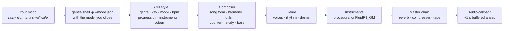

<!-- markdownlint-disable-next-line MD041 -->
<a id="top"></a>

<div align="center">

<h1>gentle-stream</h1>

<p><strong>Endless generative music in your terminal, steered by how you feel.</strong></p>

<p>


<a href="LICENSE"></a>
</p>

<p>
<a href="https://gentlemanprogramming.com/"><strong>Website</strong></a> &bull;
<a href="https://www.youtube.com/@GentlemanProgramming"><strong>YouTube</strong></a> &bull;
<a href="https://github.com/Gentleman-Programming/gentle-stream"><strong>GitHub</strong></a>
</p>

<br/>

<p>
Type <em>"rainy night in a small café"</em> and the music turns into it at the next bar, without stopping.
<a href="https://github.com/Gentleman-Programming/gentle-shell">Gentle Shell</a> reads your mood with the model you
pick, and gentle-stream composes and synthesizes the rest live, bar by bar.
<strong>It never ends, it never repeats exactly, and every note is newly composed.</strong>
</p>


</div>

<div align="center"></div>

## Features

---

### Moods, not settings — Say how it should feel

Describe a feeling, a concept, a place or a scene, in any language. Gentle Shell turns it into musical parameters (genre, key, mode, tempo, progression, instruments, energy, brightness, swing, vinyl, space, melody density) with **the model you choose**. The new style starts at the next bar while the current one keeps playing. A request takes a few seconds; if it fails, the status line says so and the music is untouched.

---

### Real composition — Not a loop

A composer plans every piece with a **song form** (intro → A → B → A' → breakdown → B' → release, then the form loops with fresh variation), cadences that resolve, passing chords, an occasional key lift, a **motif** developed by repetition, sequence, inversion and augmentation, a counter-melody in contrary motion and a bass line that walks into the next chord. Press `n` and you get a new piece with the same mood: new key, progression, melody and groove.

---

### Six genres — Lo-fi by default

Lo-fi, ambient, chiptune, synthwave, jazz, rock/metal, electro, electro house, cumbia and dubstep. The model picks the genre from your mood, or you name it (*"jazz for a rainy night"*). Each genre has its own voices, rhythmic treatment, drum patterns and master chain, and they all share the same composer. See [Genres](#genres).

---

### Procedural or sampled — Your choice, no setup required

Every instrument is synthesized out of the box. Run `gentle-stream setup-samples` once and the tonal voices and drums switch to the **FluidR3_GM** soundfont (MIT), rendered note by note with FluidSynth. If anything is missing, it falls back to the procedural instruments. See [Sampled instruments](#sampled-instruments).

---

### Seamless, real-time audio — No clicks, no gaps

The engine renders one bar at a time, with note tails ringing into the next bar, and runs the result through a stateful master chain (vinyl, room, convolution reverb, tape wow, tone, bus compressor, tape saturation), so bars join seamlessly. A producer thread stays about one second ahead; the audio callback only copies samples. Pause, volume and `n` all fade or crossfade.

---

### Saved prompts — Keep what you love

Press `s` to save what is playing under a name. gentle-stream stores the prompt **and the musical parameters it produced**, so pressing `p` later brings that sound back instantly, with no model call. Every piece is still newly generated.

---

### Token-aware — You see what each mood costs

Only describing a mood calls a model. The status line shows what that call used, and the model line keeps a running total for the session. Everything else costs zero tokens. See [Token usage](#token-usage).

<div align="right"><a href="#top">Back to top</a></div>

<div align="center"></div>

## Get started

**Requirements**

| You need | Why |
| :--- | :--- |
| [uv](https://docs.astral.sh/uv/) | Installs and runs gentle-stream (Python 3.13) |
| [Gentle Shell](https://github.com/Gentleman-Programming/gentle-shell) | `gentle-shell` on your `PATH`, with at least one signed-in model provider; it interprets your moods |
| An audio output device | Playback goes through PortAudio (`sounddevice`); on Linux install your distro's PortAudio package (for example `libportaudio2`) |
| FluidSynth *(optional)* | Only for sampled instruments: `brew install fluid-synth` or your system's `fluidsynth` package |

**Install as a command**

```bash
uv tool install 'gentle-stream[samples] @ git+https://github.com/Gentleman-Programming/gentle-stream'
gentle-stream
```

**Or run from a clone**

```bash
git clone https://github.com/Gentleman-Programming/gentle-stream
cd gentle-stream
uv run gentle-stream
```

It starts playing right away. Press `/`, describe a mood, press `Enter`.

```bash
gentle-stream --mood "rainy night in a small café"        # interpret a mood on start
gentle-stream --model claude-bridge/claude-haiku-5-5      # choose the model up front
gentle-stream setup-samples                               # optional: sampled instruments (~120 MB, once)
gentle-stream --help                                      # every flag and key
```

<div align="right"><a href="#top">Back to top</a></div>

<div align="center"></div>

## How it works



| Stage | Module | What happens |
| :--- | :--- | :--- |
| **Mood** | `bridge.py` | Runs `gentle-shell -- -p --mode json --no-session -nt -ns -np -nc --no-mcp --no-themes --no-skill-registry --thinking off [--model …] "<prompt>"`, reads the answer and token usage from the final assistant `message_end` event, and extracts one JSON object |
| **Style** | `style.py` | Validates and clamps every field (`name`, `genre`, `key`, `mode`, `bpm`, `progression`, `chords`, `lead`, `drums`, `energy`, `brightness`, `swing`, `vinyl`, `space`, `lead_density`); anything missing or invalid keeps the current value |
| **Composer** | `composer.py` | Decides **what** plays in each bar: section, energy, chord, key lift, active layers, and the notes of the lead, counter-melody and bass. Pure and deterministic per seed |
| **Genre** | `genres/` | Decides **how** it sounds: voices, chord rhythm (sustained, comped, arpeggiated, strummed…), drum patterns and master settings |
| **Instruments** | `genres/*.py`, `synth.py`, `samples.py` | Procedural oscillators, envelopes and filters, or FluidR3_GM notes rendered offline by FluidSynth and level-matched to the procedural voices |
| **Engine** | `engine.py`, `mastering.py` | Mixes each bar into a buffer whose tails ring into later bars, then applies the stateful master chain: vinyl, room, procedural-IR convolution reverb, tape wow, tone, RMS bus compressor, tape saturation |
| **Player** | `player.py` | A producer thread keeps about one second of audio queued; the audio callback only copies samples, applies a smoothed gain and feeds the spectrum. The screen shows the bar you are **hearing**, not the one being rendered |
| **TUI** | `app.py` | A Textual app in the gentlemanprogramming.com palette (a `gentleman` theme: rose and pink on deep plum) |

Model extensions stay enabled on purpose: some providers (such as `claude-bridge`) are extensions.

<div align="right"><a href="#top">Back to top</a></div>

<div align="center"></div>

## Controls

| Key | Action |
| :--- | :--- |
| `space` | Play / pause (smooth fade, no clicks) |
| `n` | Next piece with the same mood: new key, progression, melody and groove |
| `/` | Describe a mood; `Enter` sends it, `Esc` leaves the input |
| `m` | Choose the model Gentle Shell uses (listed from `gentle-shell -- --list-models`); `Enter` picks, `Esc` keeps the current one |
| `s` | Save what is playing under a name; `Enter` saves (an existing name is replaced), `Esc` cancels |
| `p` | Saved prompts: `Enter` applies one instantly, `d` or `Delete` removes it, `Esc` closes |
| `j` | Journey menu: restart, skip or stop the running journey; `Enter` sends the command, `Esc` closes |
| `J` | Journey picker: create one from a description (Gentle Shell), or play a built-in or saved journey; `Enter` picks, `Esc` closes |
| `+` / `-` | Volume up / down by 5% |
| `↑` / `↓` | Volume up / down by 1% |
| `b` | Back: leave the app and keep the music playing in the background |
| `q` | Quit and stop the music (a running `gentle-shell` call is cancelled) |

### Flags

| Flag | Meaning |
| :--- | :--- |
| `--model provider/id` | Model Gentle Shell uses to interpret moods (default: Gentle Shell's default) |
| `--mood TEXT` | Mood to interpret as soon as the app starts |
| `--gentle-shell PATH` | `gentle-shell` executable to run (default: `gentle-shell`) |
| `setup-samples` | Subcommand: download the FluidR3_GM soundfont once (see below) |
| `ctl ACTION` | Subcommand: control the music playing in the background (see below) |
| `render OUT.wav` | Subcommand: render music into a WAV file, without a player or an audio device (see below) |
| `journey ACTION` | Subcommand: create, save and play journeys in the background player (see below) |

<div align="right"><a href="#top">Back to top</a></div>

<div align="center"></div>

## Background playback

The music plays in a background player, one per user, that `gentle-stream` starts on its own. Press `b` to leave the app with the music still playing; run `gentle-stream` again and it attaches to the same music (with `--mood`, the new mood is sent to it). `q` stops the music and the player.

```bash
gentle-stream ctl status   # {"running": true, "playing": true, "name": "Midnight Rain", "genre": "lofi", "mood": "", "bpm": 72.0, "target_bpm": null, "journey": null}
gentle-stream ctl tempo 110 --over 60
gentle-stream ctl glide energy=0.9 brightness=0.8 lead_density=0.9 --over 120
gentle-stream ctl pause    # also: play, toggle, next
gentle-stream ctl stop     # ends the background player
```

| Command | Output | Exit code |
| :--- | :--- | :--- |
| `ctl status` | One JSON line (`journey` is the running journey's progress, or `null`; `binaural` the binaural setting, or `null`); just `{"running": false}` when nothing plays | `0` |
| `ctl play`, `pause`, `toggle`, `next`, `stop` | Nothing, or `gentle-stream: nothing is playing` on stderr | `0`, or `1` when nothing plays |
| `ctl tempo BPM [--over SECONDS]` | Glide tempo in place (default 60 seconds) | `0`, or `1` when nothing plays |
| `ctl glide FIELD=VALUE... [--over SECONDS]` | Glide `energy`, `brightness`, `space`, `swing`, `vinyl`, `lead_density`, `voice` or `bpm` in place (default 60 seconds) | `0`; `1` when nothing plays or the player refuses; `2` for a malformed or discrete field |
| `ctl binaural on [--carrier HZ] [--beat HZ] [--level L] [--over SECONDS]`, `ctl binaural set ... [--over SECONDS]`, `ctl binaural off` | Fade the binaural texture in or out, or glide it to new values (see [Binaural](#binaural)); nothing on stdout | `0`; `1` when nothing plays or `set` finds it off; `2` for a value out of range, options with `off`, or `set` without one |
| `journey play NAME\|FILE` | Run a built-in or saved journey (names ignore case) or a JSON file (see [Journeys](#journeys)); nothing on stdout | `0`; `1` when nothing plays or the name is unknown |
| `journey restart` | Restart the running journey at its first stage on the next bar | `0`; `1` when nothing plays or no journey is running |
| `journey skip` | Advance the running journey to its next stage on the next bar | `0`; `1` when nothing plays, no journey is running, or the journey has reached its final stage |
| `journey stop` | End the journey, leaving the music as it is | `0`, or `1` when nothing plays |
| `journey list` | The built-in journeys, one per line with a short description, then the saved ones | `0` |
| `journey create "DESCRIPTION" [--dry-run]` | Ask the model once (`--model`, `--gentle-shell` apply) for a journey: the normalized JSON on stdout, the token usage on stderr, then it starts; `--dry-run` only prints | `0`; `1` when the model fails, answers with no JSON object or an invalid journey, times out, or nothing plays |
| `journey save NAME FILE\|--last` | Save a JSON file, or the last journey the player started, under `NAME`: `Saved journey "NAME"` (or `Replaced`) | `0`; `1` for a built-in name, an unreadable store, nothing playing, or no journey started yet |
| `journey delete NAME` | Remove a saved journey: `Deleted journey "NAME"` | `0`; `1` when there is no saved journey with that name or it is a built-in |

A glide changes the piece that is playing instead of starting a new one: the song form keeps going, and each bar takes the values at its start. Each field glides on its own (a second `glide` adds to or replaces per field), values are clamped like a mood's, and a new mood or `next` cancels every glide. Discrete fields (genre, key, mode, instruments, drums) only change with a new piece. Genres that pick something once per piece from the tempo (chiptune's arpeggio speed) keep the value the piece started with. If the background player is older than the command, `ctl` says so: run `gentle-stream ctl stop` and start again.

The player listens on a Unix socket in a private directory (`$XDG_RUNTIME_DIR/gentle-stream`, default `~/.cache/gentle-stream/run`, mode `0700`), authenticated with a random key in a `0600` file. A player that crashed is detected and replaced on the next start. If the audio output cannot be opened, `gentle-stream` prints the error and exits with `1`.

<div align="right"><a href="#top">Back to top</a></div>

<div align="center"></div>

## Vocals

A wordless choir can sing under any genre: a soft "aah" pad on the upper tones of each chord, voice-led from chord to chord, carried by the genre's own room and reverb. It has no words and works procedurally without a download. With FluidSynth and FluidR3_GM installed (`gentle-stream setup-samples`), it uses Choir Aahs or Voice Oohs for acoustic genres and Synth Voice for synthwave, electro, electrohouse, dubstep and chiptune. The sampled voices are level-matched to the procedural reference through `Program.rms`; without the soundfont, the procedural choir remains available. `voice` (0 to 1, default 0) sets its level; it glides like the other continuous fields and a mood can ask for it:

```bash
gentle-stream ctl glide voice=0.6 --over 30
gentle-stream --mood "ambient with ethereal wordless choir"
```

Journeys can bring the choir in and out with a stage target such as `"to": {"voice": 0.5}`. While audible, the TUI shows `Vocals: choir (sampled) · 50%` (or `procedural`); it hides the line at zero. `gentle-stream ctl status` includes a `vocals` object with `backend` and the audible `level` from 0 to 1. When attached to an older daemon without vocal status, the backend is reported as `unknown`.

The choir can also sing the melody, but that mode waits for a voice that sings melodies convincingly: the General MIDI choirs and the procedural voice sound metallic or flute-like on a melody, so until a voice pack provides one (planned for a later milestone) the choir stays a pad at any `voice` and the genre keeps its lead. With such a voice, at `voice >= 0.5` and when the lead layer plays, the singer replaces the genre's instrumental lead with the composer's wordless melody. Connected notes up to four semitones apart glide over 90 ms; larger intervals and notes after rests start at their target pitch. Short overlapping releases provide legato, and vibrato enters after 300 ms and grows on long notes. The vowel alternates between "o" and "u" every four bars within a section. Sampled melodies retain the soundfont timbre through variable-rate playback; without samples the same articulation uses a procedural formant voice.

With a melodic voice, at high section energy the singer is doubled by harmony parts: one from energy 0.7 (where the counter-melody also enters), two from 0.9, never more. Each harmony note keeps the melody's rhythm and is a chord tone of the chord sounding at its beat, a third or sixth below the voice above when the chord offers one, so the parts move with the melody and never double it at the unison or octave. The parts sit left and right of the melody, quieter, and high-passed at 180 Hz so they do not cloud the mix.

Otherwise the choir is a pad. Its vowel follows the song form: "aah" where the melody plays, "ooh" in the intro, breakdown and release. Each procedural voice is a band-limited source through three vowel formants (around 800, 1200 and 2500 Hz for "aah"), with a vibrato that enters after the onset and a little breath. With `voice` at 0 nothing of it runs, so the music is exactly as before; saved prompts from before it load with `voice` 0.

<div align="right"><a href="#top">Back to top</a></div>

<div align="center"></div>

## Binaural

An optional listening texture under the music, best with headphones: a quiet sine on each ear, the left one half the beat below the carrier and the right one half the beat above it. gentle-stream makes no claim about any effect it may have. It is off by default.

```bash
gentle-stream ctl binaural on --carrier 200 --beat 6 --level 0.05   # fades in: 197 Hz left, 203 Hz right
gentle-stream ctl binaural set --beat 10 --over 30                  # glides to 195 / 205 Hz over 30 seconds
gentle-stream ctl binaural off                                      # fades out
```

| Option | Range | Default |
| :--- | :--- | :--- |
| `--carrier HZ` | 40–1000 | 200 |
| `--beat HZ` | 0.5–40 (the difference between the ears) | 6 |
| `--level L` | 0–0.08 (each tone's amplitude) | 0.05 |

The layer is added after the master chain, so no reverb, tape wow, tone filter or compressor touches it, and the music's ceiling (0.9) plus the highest level stays below full scale. Turning it on fades it in from silence over 2 seconds and turning it off fades it out the same way. While it plays, `on` with new values or `set` (only the values given) glides there over `--over` seconds (default 60, `0` changes at the next bar): the frequencies move smoothly, never the phase, so the tones never jump. `next` crossfades over about 80 ms, during which the layer's level dips briefly, without a click. The app shows `Binaural: 200 Hz carrier · 6 Hz beat · 5% · headphones recommended` under the journey line while it is on, and `ctl status` reports `binaural` as `{"carrier", "beat", "level"}` (where it is heading) or `null`.

<div align="right"><a href="#top">Back to top</a></div>

<div align="center"></div>

## Journeys

A journey moves the music on its own, stage by stage: tempo, energy and colour glide from where the music is to each stage's values, then the last stage holds forever (`sustain`) or hands the music back as it is (`release`). It runs inside the background player, so it keeps going after you leave the app, and it pauses when the music pauses.

```bash
gentle-stream journey list             # built-ins, including ambient-to-synthwave
gentle-stream journey play ambient-to-synthwave
gentle-stream journey play warm-up
gentle-stream journey validate ./sunrise.json > normalized.json
gentle-stream journey show ambient-to-synthwave > journey.json
gentle-stream journey play ./sunrise.json
gentle-stream journey stop             # the music stays where the journey left it
```

Describe one in words and keep the ones you like. `create` is the only command that calls a model; saved journeys live in `journeys.json` next to `presets.json` (`$XDG_CONFIG_HOME/gentle-stream/`, default `~/.config`), written atomically like the saved prompts, and play by name like the built-ins (whose names cannot be reused):

```bash
gentle-stream journey create "20-minute ambient to energetic 118 bpm synthwave, then keep it going"
gentle-stream journey save "Morning run" --last
gentle-stream journey play "morning run"
gentle-stream journey create --dry-run "slow rainy evening" > rainy.json
gentle-stream journey save "Rainy evening" rainy.json
gentle-stream journey delete "Rainy evening"
```

| Journey | Stages | End |
| :--- | :--- | :--- |
| `ambient-to-synthwave` | The 20-minute reference: Dawn (3 min, ambient, 60 bpm, no drums or melody, binaural 200 Hz / 6 Hz fades in), Drift (3 min, ambient, melody enters), Chillout (4 min, lo-fi, 8-bar crossfade, drums enter), Lift (3 min, lo-fi, 98 bpm, binaural fades out), Synthwave (4 min, 8-bar crossfade, counter-melody), Peak (3 min, synthwave, 118 bpm); drums build with the energy ([listening checklist](docs/FLAGSHIP_LISTENING_CHECKLIST.md)) | sustain |
| `warm-up` | Settle (1 min, 60 bpm, energy 0.2), Wake (3 min, 72 bpm), Rise (4 min, 88 bpm), Glow (2 min, 100 bpm, energy 0.9); drums build with the energy | sustain |
| `wind-down` | Ease (2 min, 84 bpm), Soften (4 min, 68 bpm), Drift (4 min, 58 bpm, energy 0.15) | release |

Genre steps start a new piece at the first following four-bar boundary of the old piece, skip its quiet intro, and preserve the progression and journey fields; shared tails continue ringing. The key and mode stay when the new genre plays that mode; otherwise the step lands on the new genre's most typical mode that shares the same notes (C lydian into synthwave becomes E minor), and the last bar before it ends on the dominant seventh of the new key, so the change sounds prepared. The new piece also opens its melody with the first bar of the old one's motif, in the new key, and keeps developing from it, so the tune stays recognisable from stage to stage (`next` and a new mood still start a fresh one). A journey owns the fields it moves: a new mood or `next` keeps it running, and the new piece takes the journey's tempo, energy and colour from its first bar (the rest of the mood applies as usual). Starting a journey cancels glides of those fields and replaces a running journey; while it runs, trying to glide one of those fields is rejected until you stop the journey. Journey time is rendered time, so `next` advances it by the buffered audio it drops (up to about one second). Genre stages switch at phrase boundaries. `gentle-stream render --journey warm-up` renders one offline.

While a journey runs, you can control it with `j` in the TUI (restart, skip, or stop), or from the command line with `gentle-stream ctl journey restart`, etc. The app shows its progress under the mood, following what you hear (not what is rendered ahead), and hides the line otherwise:

```text
Journey: Warm-up · stage 2/4 "Wake" · 62% · 67 → 72 bpm · 7:08 left
Journey: Warm-up · stage 4/4 "Glow" · 100% · 100 bpm · sustaining
```

The tempo shows one value when the stage ends at the tempo it has (`100 bpm`), and `sustaining` replaces the time left once a sustaining journey holds its last stage. `ctl status` reports the same as JSON:

```json
"journey": {"name": "warm-up", "title": "Warm-up", "stage": 2, "stages": 4, "stage_name": "Wake", "progress": 0.62, "bpm": 67.4, "target_bpm": 72.0, "seconds_left": 428.4}
```

`stage` counts from 1, `progress` is through the stage (0 to 1), `target_bpm` is the tempo at the end of the stage and `seconds_left` is `null` while sustaining. A journey that moves the binaural layer also reports `"binaural": {"carrier", "beat", "level"}` at the bar's start (`null` otherwise).

A stage can switch parts off and on with an optional `layers` block (`chords`, `bass`, `drums`, `lead`, `counter`): drums can enter in stage 2 and the lead in stage 3. Every part starts on, each switch holds until a later stage changes it, and changes land on the next 4-bar phrase boundary; a part switched on still plays only where the song form gives it (no drums in an intro):

```json
{"name": "Bare", "seconds": 120, "layers": {"drums": false, "lead": false}}
```

A stage that changes genre can ask for a gradual step with `"transition": {"bars": 8}` (1 to 32 bars): from the phrase where the step would happen, both genres play together and crossfade at equal power, through one master chain whose settings move from the old genre's to the new one's, and then the new piece carries on alone. `next` or a new mood during the crossfade drops the incoming piece.

Drums can build with the journey. `"drums": "energy"` at the top of a journey maps the energy to a drum level (below 0.25 none, then soft, lofi, and busy from 0.75), and a stage's `"drums": "lofi"` names a level held from then on (it wins over the energy). The drums move one level per 4-bar phrase, never skipping one: `none → soft → lofi → busy`.

A stage can also move the [binaural layer](#binaural) with an optional block, interpolated with the stage's curve like the other fields; a stage without one holds the values reached so far, and `level` 0 fades it out:

```json
{"name": "Ambient", "seconds": 60, "genre": "ambient", "to": {"bpm": 60}, "binaural": {"carrier": 200, "beat": 6, "level": 0.05}}
```

Values outside the ranges are clamped with a warning, like the other fields. A journey with binaural blocks starts from the layer that plays (from silence when it is off) and owns it while it runs: `ctl binaural` is refused until you stop the journey, and stopping it leaves the layer where it was. A journey without binaural blocks never touches the layer. `journey create` may add the block when the description asks for it.

<div align="right"><a href="#top">Back to top</a></div>

<div align="center"></div>

## Render to a file

`gentle-stream render` writes music to a WAV file with the engine alone: no background player, no audio device, faster than real time.

```bash
gentle-stream render --seconds 60 --genre synthwave /tmp/synth.wav   # wrote /tmp/synth.wav: 60 s, synthwave, seed 1234567
gentle-stream render --seed 1234567 --genre synthwave /tmp/again.wav # the same seed and style write the same bytes
```

| Flag | Meaning |
| :--- | :--- |
| `OUT.wav` | The file to write: 16-bit PCM, stereo, at the engine's sample rate (44.1 kHz) |
| `--seconds N` | Length, above 0 and at most 3600 (default: 60); the last bar is trimmed to the exact length |
| `--seed S` | Seed for the piece, a non-negative integer (default: random; the line printed at the end shows it) |
| `--genre NAME` | Genre, overriding the mood file's; an unknown name lists the valid ones |
| `--mood-file STYLE.json` | A style as JSON (the fields of `Style`, e.g. `{"genre": "jazz", "bpm": 120, "energy": 0.9}`); missing or invalid fields fall back to the defaults |
| `--journey NAME` | Run a built-in journey from the first bar (see [Journeys](#journeys)); an unknown name lists the valid ones |
| `--procedural` | Use the procedural instruments even when the soundfont is installed |

A file or path that cannot be read or written prints one `gentle-stream: ...` line and exits with `1`; invalid flags exit with `2`. A minute of audio is about 10 MB.

<div align="right"><a href="#top">Back to top</a></div>

<div align="center"></div>

## Token usage

After each interpretation the status line shows what that call used, and the model line keeps the session total:

```text
Up next: Café Rain · lofi · F dorian · 74 bpm · 1-4-7-3 · rhodes/piano · drums lofi · 17.7k tokens · $0.0001
model: claude-bridge/claude-haiku-5-5 · session: 35.4k tokens · $0.0015
```

| Action | Calls a model? |
| :--- | :--- |
| Describing a mood (`/` or `--mood`) | **Yes** — the only thing that does |
| Playback, `space`, `n`, volume | No |
| Saving (`s`) or applying (`p`) a prompt | No |
| Failed or cancelled requests | Add nothing to the total |

The cost is the one Gentle Shell reports, in US dollars. Providers used through a subscription (such as `claude-bridge`) report `$0.0000`. Opening the model picker runs `gentle-shell -- --list-models`, which lists models without calling one.

<div align="right"><a href="#top">Back to top</a></div>

<div align="center"></div>

## Saved prompts

| | |
| :--- | :--- |
| **Save** | `s`, type a name (up to 40 characters), `Enter` |
| **Apply** | `p`, pick one, `Enter` — starts at the next bar and sounds like it did when you saved it |
| **Delete** | `p`, highlight one, `d` or `Delete` |
| **File** | `~/.config/gentle-stream/presets.json` (or `$XDG_CONFIG_HOME/gentle-stream/presets.json`) |
| **Format** | Plain JSON with the prompt and its musical parameters, rewritten atomically |
| **Safety** | An unreadable file is reported and never overwritten; invalid entries are skipped; every value is validated like a model answer, so a hand-edited file still plays |

<div align="right"><a href="#top">Back to top</a></div>

<div align="center"></div>

## Genres

The genre is part of the style: it shows on the details line, survives `n` and is kept by saved prompts (prompts saved before genres existed load as lo-fi). A request that only adjusts the music keeps the current genre.

| Genre | Sound | Typical tempo | With samples |
| :--- | :--- | :--- | :--- |
| `lofi` *(default)* | Felt piano, rhodes, nylon guitar or warm pad, sub bass, dusty swung drums, vinyl crackle, small room, tape wow | 60–92 bpm | FluidR3_GM piano, rhodes, nylon, pad and drums; the sub stays synthesized |
| `ambient` | Slow swelling additive pads, a high FM celesta, sustained sub, starlight air; no drums, a lot of space, clean wide master | 50–80 bpm | Warm Pad, Space Voice, Celesta, Orchestral Harp, piano; sub and air stay synthesized |
| `chiptune` | Four 8-bit channels: pulse lead, fast pulse arpeggios, stepped triangle bass, noise drums; dry and bright | 100–140 bpm | Always procedural (samples do not fit 8-bit) |
| `synthwave` | Detuned saw pads with opening filters, saw/square lead with echo, 16th arpeggiator, pulsing octave bass, gated-reverb snare | 80–118 bpm | Saw Lead, Polysynth, Synth Bass and the Electronic kit, with the gated tail layered on |
| `jazz` | Extended chords, rootless swung comping, walking upright bass, brushes and a spang-a-lang ride, strong swing | 60–140 bpm | Acoustic bass, piano, rhodes, jazz guitar, vibraphone, tenor sax, Jazz and Brush kits |
| `rock` | Double-tracked palm-muted power chords, picked bass, lead guitar, driving drums, crash on every section | 90–140 bpm | Distortion, Overdriven and Clean Guitar, Picked Bass, Strings and the Power kit |
| `electro` | Classic electro-funk: syncopated 808 breakbeats (never four-on-the-floor), funky 16th synth bass, robotic square riffs and arpeggios, cowbell; tight and dry | 100–130 bpm | The real TR-808 kit, Saw/Square Lead, Synth Bass, Synth Strings |
| `electrohouse` | Four-on-the-floor kick, clap on 2 and 4, off-beat open hats, dirty distorted bass riffs, sidechain-pumped supersaws, risers and snare rolls into drops | 124–132 bpm | Electronic kit, Saw Lead, Polysynth; the dirty bass stays synthesized |
| `cumbia` | Guacharaca "ch-chik", tambora and congas, root-fifth bass with pickups, off-beat keyboards, accordion lead (digital-cumbia synth when bright) | 85–110 bpm | Guiro, congas, maracas, cabasa, timbales, Finger Bass, Accordion, Tango Accordion, Drawbar Organ |
| `dubstep` | 140 bpm half-time drums, deep sine sub, LFO wobble bass synced to 1/4–1/16 and triplets, growls, risers and drops | 136–140 bpm | Power and Standard kit drums; sub, wobble, growl and risers stay synthesized |

`rock` covers metal too: with busy drums at energy 0.7 or more it switches to 16th-note chugs and gallops, double kick and china accents.

The four shared tone colours (`piano`, `rhodes`, `nylon`, `pad`) mean something different in each genre (in chiptune they are pulse widths, in rock they are guitars), so the model's answer schema and saved prompts stay the same everywhere.

**Adding a genre** touches one module in [`src/gentle_stream/genres/`](src/gentle_stream/genres/); [`base.py`](src/gentle_stream/genres/base.py) documents the interface, and [`tests/test_genres_contract.py`](tests/test_genres_contract.py) checks every registered genre on both backends.

<div align="right"><a href="#top">Back to top</a></div>

<div align="center"></div>

## Sampled instruments

Optional. Without them every instrument is synthesized and nothing is ever downloaded.

```bash
brew install fluid-synth            # or your system's fluidsynth package
gentle-stream setup-samples         # downloads ~120 MB once; running it again does nothing
```

| | |
| :--- | :--- |
| **What** | The FluidR3_GM General MIDI soundfont, rendered note by note with FluidSynth through `pyfluidsynth` |
| **Source** | Debian's `fluid-soundfont-gm` package: `https://deb.debian.org/debian/pool/main/f/fluid-soundfont/fluid-soundfont-gm_3.1-5.3_all.deb` |
| **Integrity** | Checked against a pinned SHA-256 before extraction; on any failure nothing is left behind |
| **Location** | `~/.cache/gentle-stream/FluidR3_GM.sf2` (or `$XDG_CACHE_HOME/gentle-stream/`), with a `LICENSES.txt` next to it recording source, checksum and license |
| **License** | MIT — Copyright © 2000-2002, 2008 Frank Wen; © 2008 Toby Smithe. Music made with it can be used commercially; keep the MIT notice from `LICENSES.txt` |
| **Binding** | `pyfluidsynth`, the `samples` extra: included by `uv run` in a clone, and by the `[samples]` install above; add it to a clone with `uv sync --extra samples` |
| **Fallback** | If the soundfont, FluidSynth or the binding is missing, the procedural instruments play. The genre's master chain applies to both |

**License policy.** Only assets whose license is verified at the original source, and that allow commercial use of the resulting music, are accepted. The soundfont is never committed to or shipped with this repository. **GeneralUser GS was rejected**: it allows commercial music, but its author states they cannot be 100% sure where all of the samples originated. The reverb uses an impulse response generated by gentle-stream's own code, not a recording.

<div align="right"><a href="#top">Back to top</a></div>

<div align="center"></div>

## Originality

All music is generated: the composer builds every melody, counter-melody, bass line and progression from scratch for each piece. The model is told to **never reproduce existing melodies, songs, riffs or soundtracks**, even when your mood names one; it only captures the general feel (genre, tempo, colour, energy). Model answers are reduced to bounded parameters, so a model cannot inject notes.

<div align="right"><a href="#top">Back to top</a></div>

<div align="center"></div>

## Project layout

| Path | What it holds |
| :--- | :--- |
| [`src/gentle_stream/__init__.py`](src/gentle_stream/__init__.py) | CLI: flags, `setup-samples`, `ctl`, `render`, attaching to or starting the background player |
| [`src/gentle_stream/daemon.py`](src/gentle_stream/daemon.py) | The background player process: audio output, private socket, single instance |
| [`src/gentle_stream/client.py`](src/gentle_stream/client.py) | Attach to, start and control the background player (same interface as the in-process player) |
| [`src/gentle_stream/app.py`](src/gentle_stream/app.py) | Textual TUI, theme, spectrum, model picker, save and saved-prompt dialogs |
| [`src/gentle_stream/bridge.py`](src/gentle_stream/bridge.py) | Gentle Shell call, prompt, JSON and token-usage parsing, cancellation |
| [`src/gentle_stream/style.py`](src/gentle_stream/style.py) | The musical parameters and their validation; `n` variations |
| [`src/gentle_stream/composer.py`](src/gentle_stream/composer.py) | Song form, harmony, motif development, counter-melody, bass |
| [`src/gentle_stream/engine.py`](src/gentle_stream/engine.py) | Bar-by-bar rendering and the master chain |
| [`src/gentle_stream/mastering.py`](src/gentle_stream/mastering.py) | Procedural impulse response, convolution reverb, bus compressor, soft clip |
| [`src/gentle_stream/vocals.py`](src/gentle_stream/vocals.py) | The wordless choir: formant voices and their voicing |
| [`src/gentle_stream/binaural.py`](src/gentle_stream/binaural.py) | The optional binaural layer: settings and the phase-continuous sine pair |
| [`src/gentle_stream/player.py`](src/gentle_stream/player.py) | Real-time playback, buffering, crossfades, spectrum |
| [`src/gentle_stream/samples.py`](src/gentle_stream/samples.py) | Soundfont download and verification, FluidSynth rendering |
| [`src/gentle_stream/synth.py`](src/gentle_stream/synth.py) | Shared oscillators, envelopes, filters, waveshaper |
| [`src/gentle_stream/presets.py`](src/gentle_stream/presets.py) | Saved prompts storage |
| [`src/gentle_stream/genres/`](src/gentle_stream/genres/) | One module per genre plus the registry |
| [`tests/`](tests/) | pytest suite, including TUI tests driven through Textual's test pilot with a fake audio stream |
| [`odd/tasks/`](odd/tasks/) | Feature documents: specs, tasks and evidence for every change |

## Tests

```bash
uv run pytest
```

The suite needs no audio device and no Gentle Shell: the player and the TUI are tested with a fake output stream and a fake shell. `tests/test_flagship_journey.py` renders the 20-minute flagship journey to check its regression metrics (tempo, loudness and onset density rising); it is marked `slow`, so `uv run pytest -m "not slow"` skips it. When the soundfont is installed, the player and app tests run on the sampled backend.

<div align="right"><a href="#top">Back to top</a></div>

<div align="center"></div>

## Contributing

gentle-stream is built with [Gentle-AI](https://github.com/Gentleman-Programming/gentle-ai) and its **Organic Driven Development (ODD)** workflow:

1. **Open an issue first** describing the behavior you want.
2. **Substantial work gets a feature document** in [`odd/tasks/`](odd/tasks/) with the request, specs, tasks and evidence (see the existing ones for the shape).
3. **Test first**: add a failing behavior test, make it pass, then refactor while `uv run pytest` stays green.
4. **Keep it original and licensed**: no melodies of existing works, and only assets with a verified free license.

<div align="right"><a href="#top">Back to top</a></div>

<div align="center"></div>

## About the author

Built by [Alan Buscaglia](https://github.com/Gentleman-Programming) (Gentleman Programming). The lo-fi sound started as the procedural bed behind the Gentleman Programming YouTube videos; gentle-stream renders it live and lets you steer it.

<div align="center">

<a href="https://gentlemanprogramming.com/"></a>
<a href="https://www.youtube.com/@GentlemanProgramming"></a>
<a href="https://github.com/Gentleman-Programming"></a>

</div>

---

<div align="center">


<br/>

<h3>gentle-stream is crafted with Gentle-AI</h3>

<a href="https://github.com/Gentleman-Programming/gentle-ai">
  
</a>

<br/><br/>

<a href="LICENSE"></a>

</div>
