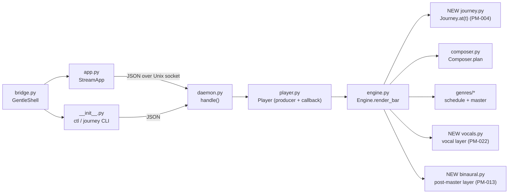

# Progressive Music Roadmap

From an endless mood-steered stream to an adaptive musical journey engine, one small pull request at a time.

- **Status:** plan only; nothing in this document is implemented yet.
- **Baseline:** `main` at `f4ffaea` (2026-10-26), `uv run pytest`: 385 passed, 27 skipped.
- **Reading order:** sections 1–3 explain *why* the order is what it is; section 4 is the executable backlog;
  sections 5–8 are for planning and review.

---

## 1. Executive summary

### 1.1 What the repository does today (confirmed by reading the code)

| Capability | Where | Notes relevant to this roadmap |
| :--- | :--- | :--- |
| Endless bar-by-bar rendering | `engine.py` `Engine.render_bar` | One bar per call; `n = round(240 / style.bpm * sr)`; note tails ring into later bars through a shared 24 s accumulation buffer (`_acc`). |
| Stateful master chain | `engine.py` `_master`, `mastering.py` | Reverb, room, vinyl, tape wow, tone, compressor and soft clip keep state across bars; gains glide over 50 ms (`_glide`). Output ceiling is 0.9. |
| Composition | `composer.py` `Composer.plan(bar)` | Pure and deterministic per seed; plans one song-form cycle at a time (intro + 40 bars, then 40-bar loops). It works in bars and beats only and never reads `bpm`. |
| Genres | `genres/*.py`, `genres/base.py` | Ten genres. Each `schedule` reads `piece.style` on every bar and derives the beat length (`B = 60 / s.bpm`) per bar. Tempo ranges include `ambient` 50–80, `lofi` 60–92, `synthwave` 80–118. |
| Style | `style.py` `Style` | Frozen dataclass; `from_dict` clamps untrusted input (`bpm` 50–140) and ignores unknown keys. |
| **Any style change starts a new piece** | `engine.py` `queue_style` → `_start_piece` | New seed, new composer, bar 0, intro section. **There is no way today to change tempo or energy without restarting the music's form.** This is the main gap. |
| Player | `player.py` | A producer thread keeps ~1 s rendered ahead; the audio callback only copies samples. "Now playing" metadata travels with each rendered bar (`NowPlaying`). |
| **Elapsed time assumes a constant tempo** | `player.py` `elapsed_seconds` | `now.bar * engine.bar_seconds` uses the tempo being *rendered*. It becomes wrong as soon as tempo varies inside a piece. A hidden prerequisite of the first deliverable. |
| Background player | `daemon.py`, `client.py` | One per user, JSON over an authenticated Unix socket; `ctl` actions `play`, `pause`, `toggle`, `next`, `stop`, `status`. The daemon owns `Engine` + `Player`, so anything that must survive the TUI leaving belongs on the daemon side. |
| Mood → style | `bridge.py` `GentleShell` | One `gentle-shell -p --mode json` call per mood; JSON validated through `Style.from_dict`; token usage reported. |
| Saved prompts | `presets.py` | Versioned JSON, atomic rewrite, corrupt files never overwritten. A good pattern to reuse for journeys. |
| Sampled instruments | `samples.py` | Optional FluidR3_GM (MIT) via FluidSynth, pinned SHA-256 download, `LICENSES.txt`. `load_renderer(path)` is cached per soundfont path, so a second SF2 can be loaded independently. `SampleInstruments.play(Program(n))` renders **any** GM program. |
| Test seams | `tests/` | Fake audio streams (`FakeStream`, `GENTLE_STREAM_AUDIO_FACTORY`), offline engine rendering, isolated runtime dirs. No audio hardware is needed. |

### 1.2 What is missing

1. **In-place evolution**: continuous parameters (tempo, energy, brightness, space, density) cannot change without a
   new piece.
2. **Journeys**: no timeline, stages, interpolation, sustain or progress.
3. **Binaural layer**: nothing generates independent left/right tones.
4. **Musical continuity across genres**: a genre change is a hard new piece that restarts at the intro (energy dips to
   0.3).
5. **Vocals**: none. FluidR3_GM already contains Choir Aahs (GM 53), Voice Oohs (GM 54) and Synth Voice (GM 55), and
   `ambient` already uses GM 92 "Pad 4 (choir)/Space Voice" as a texture (programs are 1-based here; code uses
   0-based `Program(52)`, `Program(53)`, `Program(54)`, `Program(91)`).
6. **Spoken phrases / TTS**: none.
7. **Journey-level natural language**: one mood maps to one style, not to a timeline.

### 1.3 Main technical challenges

- Changing tempo while note tails, delays and the song form keep running, without clicks.
- Keeping the composer deterministic (and existing output bit-identical) while making energy and density live.
- Changing genre (instrument set, drum language, master chain) without an audible seam or an energy dip.
- Adding layers (binaural, vocals) without breaking the > 4x real-time render budget the tests enforce.
- Version skew between a running background player and a newer TUI.
- Licensing of any audio asset that is not FluidR3_GM.

### 1.4 Proposed architecture (one sentence per decision)

- **Evolve in place:** the engine gets a second way to apply parameters, `evolve`, which updates `style` on the
  current piece at a bar boundary; `queue_style` keeps meaning "new piece".
- **Journey runner lives in the engine**, evaluated once per bar on the *rendered* timeline, so it runs inside the
  background player, survives the TUI leaving, pauses for free when playback pauses, and is testable offline.
- **Tempo is piecewise constant per bar**; at journey rates (≈0.1–0.5 bpm per bar) the steps are inaudible.
- **Continuous fields interpolate; discrete fields (genre, key, drums, instruments) switch only at phrase boundaries.**
- **Binaural is a post-master stereo layer** with its own phase accumulators, outside `Style`.
- **Vocals start as a cross-genre layer** scheduled through `Piece.add`: procedural formant choir first, then GM
  choir programs, then user-supplied packs.
- **Natural language produces a whole journey in one model call**, validated like `Style.from_dict`; the journey
  then runs with zero further calls.

### 1.5 Recommended sequence

1. **Live evolution** (tempo, then energy and colour) — the smallest change with the largest effect.
2. **Autonomous journey MVP** — stages, sustain, progress display, genre steps.
3. **Configurable journeys** (files, controls, curves), then **natural-language journeys** — the product headline,
   delivered early because it only needs a schema and one prompt.
4. **Binaural**, **musical continuity**, **vocal textures**, **own voice packs**, **spoken phrases**, **full NL
   orchestration**.

Binaural (PM-013) and vocal textures (PM-022) have no dependency on the journey track and can start in parallel at
any time.

### 1.6 Major risks and trade-offs

- Per-bar tempo steps are a deliberate simplification over sample-accurate tempo warping (see D3).
- Genre switches at phrase boundaries come first; true two-genre crossfades cost double CPU while they last (PM-020).
- Realistic singing and text-to-song are **not** part of the committed backlog; they are research (section 8).
- Third-party voice packs are user-supplied unless their license is verified as redistributable (CC0/MIT-like).

### 1.7 Assumptions that require verification

| ID | Assumption | Verified in |
| :--- | :--- | :--- |
| A1 | Per-bar tempo steps of ≤ 0.5 bpm are perceptually smooth in every genre. | PM-001 manual check, PM-003 renders |
| A2 | Shared tail ringing across a genre switch sounds acceptable without a crossfade. | PM-006 |
| A3 | Render speed stays > 4x real time with binaural + vocal layers on the samples backend. | PM-013, PM-022, PM-023 tests |
| A4 | Gentle Shell's `/gentle:music status` tolerates additive keys in `ctl status` JSON. | PM-001 (check gentle-pi before merging) |
| A5 | FluidR3_GM choir programs are musically usable as wordless textures. | PM-023 listening check |
| A6 | FreePats "Synth Pad Choir" archive contents match its catalogue page. | PM-030 (download and inspect before pinning) |
| A7 | A system TTS binary (`say` on macOS, `espeak-ng` on Linux) is present on target machines. | PM-031 detection + fallback |

---

## 2. Architecture assessment

### 2.1 Component map and integration points



### 2.2 Reuse, modify, add

| Module | Decision | Why |
| :--- | :--- | :--- |
| `composer.py` | **Modify lightly** (PM-002, PM-017, PM-018) | Make energy and lead density evaluated at `plan()` time instead of cycle-planning time. `_counter` and the `plays` selection draw no randomness, so output stays bit-identical for a constant style. |
| `engine.py` | **Modify** (PM-001, PM-002, PM-004, PM-006, PM-013) | Add `evolve`/glide, piece-relative time, the journey hook before `_schedule_bar`, and a post-master layer slot. Keep `queue_style` semantics. |
| `player.py` | **Modify** (PM-001, PM-005) | `NowPlaying` carries the bar's start time and journey snapshot, so the display follows the audible bar under variable tempo. The callback stays copy-only. |
| `daemon.py`, `client.py` | **Modify additively** | New commands; new state keys; the client reads new keys with defaults so it still attaches to an older player. |
| `style.py` | **Extend additively** (PM-022: `voice`) | `from_dict` already ignores unknown keys and defaults missing ones, so old presets and old players keep working. |
| `presets.py` | **Reuse the pattern**; extract the atomic-write helper when `journeys.py` becomes its second user (PM-011) | No speculative shared storage layer before then. |
| `bridge.py` | **Reuse** `GentleShell._run`, `parse_output`, `extract_json` with a second prompt (PM-010) | Same process handling, cancellation and usage reporting. |
| `samples.py` | **Reuse** `Program`, `SampleInstruments.play`, `load_renderer` (PM-023, PM-028) | GM choirs and external SF2 packs need no new rendering code. |
| `mastering.py`, `synth.py` | **Reuse** | Oscillators, envelopes, filters for binaural and formant voices. |
| `journey.py` | **New** (PM-004) | Pure data + interpolation; no I/O. |
| `binaural.py` | **New** (PM-013) | Stateful stereo oscillator pair. |
| `vocals.py` | **New** (PM-022) | Cross-genre vocal layer; later pack loaders. |
| `voicepacks.py` | **New** (PM-027) | Pack manifest, licensing, WAV-folder loading. |
| `speech.py` | **New** (PM-031) | TTS backends, rendered off the audio path. |

**Not needed:** a new audio framework, a plugin system before a second backend exists, a scheduler rewrite, a message
bus, or a database.

### 2.3 Real-time and continuity concerns

- **Audio callback:** must stay copy-only. Every new layer is rendered in `render_bar` on the producer thread.
- **Musical scheduling:** the composer is tempo-free (bars and beats); genres convert beats to seconds per bar.
  Changing `bpm` between bars is therefore structurally safe; tails already scheduled in seconds simply ring on.
- **Buffer continuity:** `_acc` is shared across pieces, so tails survive genre switches. Master-chain gain changes
  already glide; tone changes crossfade filters; IR changes keep the old tail.
- **Latency of control:** a command applies at the next *rendered* bar, which is up to ~1 s plus one bar ahead of what
  is audible. Journeys hide this because they are evaluated on the rendered timeline and displayed from the audible
  bar's metadata.
- **Background playback:** journeys, binaural and vocals live in the engine, inside the daemon process, so `b` (detach)
  and `ctl` keep working.
- **TUI communication:** the TUI polls `state` 15 times per second; new fields are a few bytes. No push channel is
  needed.

---

## 3. Feature dependency map

Only real code dependencies are drawn. Tracks without arrows between them can be developed in parallel.

```mermaid
flowchart TD
    subgraph Evolution["Live evolution"]
        PM001["PM-001 Live tempo glide"]
        PM002["PM-002 Live energy and colour glide"]
        PM003["PM-003 Offline render to WAV"]
    end
    subgraph Journey["Journeys"]
        PM004["PM-004 Journey runner + sustain"]
        PM005["PM-005 Journey progress display"]
        PM006["PM-006 Genre steps between stages"]
        PM007["PM-007 Journey files"]
        PM008["PM-008 Journey controls"]
        PM009["PM-009 Interpolation curves"]
    end
    subgraph NL["Natural language"]
        PM010["PM-010 NL journey (CLI)"]
        PM011["PM-011 Saved journeys"]
        PM012["PM-012 TUI journey prompt + picker"]
        PM034["PM-034 NL edit of running journey"]
        PM035["PM-035 Moods inside a journey"]
    end
    subgraph Bin["Binaural"]
        PM013["PM-013 Binaural layer"]
        PM014["PM-014 Smooth binaural + status"]
        PM015["PM-015 Binaural in journeys"]
    end
    subgraph Cont["Musical continuity"]
        PM016["PM-016 Harmonic handoff"]
        PM017["PM-017 Motif carried across stages"]
        PM018["PM-018 Layer entrances per stage"]
        PM019["PM-019 Rhythmic complexity ramp"]
        PM020["PM-020 Two-genre crossfade"]
        PM021["PM-021 Curated flagship journey"]
    end
    subgraph Voc["Vocal textures"]
        PM022["PM-022 Procedural wordless choir"]
        PM023["PM-023 Sampled GM choir"]
        PM024["PM-024 Vocals in journeys + status"]
        PM025["PM-025 Wordless vocal melody"]
        PM026["PM-026 Vocal harmonies"]
    end
    subgraph Packs["Own voice packs"]
        PM027["PM-027 WAV voice packs + licensing"]
        PM028["PM-028 SF2 voice packs"]
        PM029["PM-029 SFZ subset"]
        PM030["PM-030 setup-voices (CC0 pack)"]
    end
    subgraph Speech["Spoken phrases"]
        PM031["PM-031 TTS phrase layer"]
        PM032["PM-032 Phrases in journeys"]
        PM033["PM-033 Voice characteristics"]
    end
    PM001 --> PM002 --> PM004
    PM004 --> PM005
    PM004 --> PM006
    PM004 --> PM007
    PM004 --> PM008
    PM004 --> PM009
    PM007 --> PM010
    PM007 --> PM011
    PM010 --> PM012
    PM011 --> PM012
    PM010 --> PM034
    PM010 --> PM035
    PM013 --> PM014 --> PM015
    PM007 --> PM015
    PM006 --> PM016
    PM006 --> PM017
    PM004 --> PM018
    PM004 --> PM019
    PM006 --> PM020
    PM016 --> PM021
    PM018 --> PM021
    PM019 --> PM021
    PM003 --> PM021
    PM022 --> PM023
    PM022 --> PM024
    PM004 --> PM024
    PM022 --> PM025 --> PM026
    PM022 --> PM027
    PM027 --> PM028
    PM027 --> PM029
    PM028 --> PM030
    PM031 --> PM032
    PM007 --> PM032
    PM031 --> PM033
```



**Independent starting points:** PM-001, PM-003, PM-013, PM-022, PM-031.

---

## 4. Incremental implementation backlog

Conventions for every item:

- Each item is one pull request, one Conventional Commit series, tests included, `uv run pytest` green.
- "Docs" means: `README.md`, the `CONTROLS` help text in `src/gentle_stream/__init__.py`, and the daemon protocol
  docstring in `daemon.py` whenever a command, flag, key or message changes.
- Every engine-touching item keeps the existing guarantees: bars join without clicks, output `< 1.0`, deterministic
  per seed and command sequence, > 4x real time (`tests/test_engine.py`, `tests/test_genres_contract.py`).
- New daemon commands are additive; the client reads new state keys with defaults; an older player answering
  `unknown command` produces the message *"the running player is older than this gentle-stream; run
  `gentle-stream ctl stop` and start again"*.

---

### Milestone M1 — Live evolution

#### PM-001 — Live tempo glide

- **User value:** `gentle-stream ctl tempo 118 --over 300` makes the music that is playing accelerate gradually over
  five minutes, without restarting the piece; the TUI shows the tempo changing and the elapsed time stays correct.
- **Scope:**
  - `Engine.queue_tempo(bpm, seconds)` (thread-safe, same lock pattern as `queue_style`).
  - At each bar boundary, before scheduling, the engine computes the bar's tempo by linear interpolation over the
    rendered seconds since the glide started and applies it **in place**: `style = replace(style, bpm=...)`, also on
    `self._piece.style` and `self.composer.style`. No new piece, bar counter continues. `seconds == 0` applies at the
    next bar.
  - A new style (`queue_style`) or `next` cancels the glide (documented).
  - The engine tracks piece-relative seconds; `NowPlaying` gains the bar's start time so `Player.elapsed_seconds` is
    exact under variable tempo; `cycle_remaining_seconds` is estimated at the audible bar's tempo.
  - Daemon command `{"cmd": "tempo", "bpm": float, "seconds": float}`; bpm clamped to 50–140, seconds 0–3600;
    NaN, infinities and non-numbers rejected with `bad request`.
  - CLI `gentle-stream ctl tempo BPM [--over SECONDS]` (default 60 s); exits 1 with `gentle-stream: nothing is
    playing` like the other actions.
  - `ctl status` gains `"bpm"` (audible) and `"target_bpm"` (or `null`).
- **Out of scope:** other parameters, curves, journeys, TUI keys, tempo changes inside a bar.
- **Technical approach:** a small `_Glide` record (start seconds, from, to, duration) stored on the engine; evaluated
  in `render_bar` before `_schedule_bar`. Round bpm to 0.1 as `Style.from_dict` does. The existing `ctl` parser keeps
  its actions; `tempo` becomes an action with its own arguments (subparser or `nargs`), and the old actions keep
  their exact output.
- **Affected components:** `engine.py`, `player.py`, `daemon.py`, `client.py`, `__init__.py`, `README.md`; tests in
  `test_engine.py`, `test_player.py`, `test_daemon.py`, `test_main.py`.
- **Dependencies:** none.
- **Acceptance criteria:**
  1. After `queue_tempo(120, s)` from 72 bpm, rendered bar lengths decrease monotonically and the last bar after `s`
     seconds has length `round(2.0 * sr)`.
  2. `engine.piece` is unchanged and `engine.bar` keeps incrementing during the glide.
  3. Bar boundaries during the glide pass the existing "no clicks" check.
  4. Two engines with the same seed and the same command at the same bar render identical audio.
  5. `Player.elapsed_seconds` equals the sum of the audible bars' durations plus the read offset.
  6. Invalid requests (`"bpm": "fast"`, NaN, missing field) answer `{"ok": false, "error": "bad request: ..."}` and
     leave the style unchanged.
  7. `ctl tempo` with no player prints `gentle-stream: nothing is playing` on stderr and exits 1; `ctl
     play|pause|toggle|next|stop|status` behave exactly as before.
- **Testing:** unit tests above with the procedural backend; a differential check of the existing `ctl` actions
  against the base commit; a daemon test with `FakeAudio`. Manual: run the app, `ctl tempo 110 --over 60` from
  another terminal, listen for clicks and watch the details line.
- **Demo:** `gentle-stream` (press `b`), then `gentle-stream ctl tempo 118 --over 120`, then `gentle-stream` again to
  watch the bpm climb.
- **Estimated effort:** 3.5 h.
- **Risks:** genres that cache tempo-derived values in `start` (e.g. `chiptune` arpeggio division) keep the start
  value: acceptable, document it. A4 (gentle-pi parsing `ctl status`).

#### PM-002 — Live glide of energy, brightness, space and melody density

- **User value:** `gentle-stream ctl glide energy=0.9 brightness=0.8 --over 120` makes the same piece build up
  (drums harder, filter opening, more melody) without restarting.
- **Scope:**
  - Generalise PM-001's glide to the continuous fields `bpm`, `energy`, `brightness`, `space`, `swing`, `vinyl`,
    `lead_density` (one glide per field, each with its own target and duration).
  - Composer: keep the section base energy in `_Bar`; `plan()` multiplies it by `0.5 + style.energy` at plan time;
    the counter-melody is planned for every main section and enabled in `plan()` when the plan-time energy reaches
    `COUNTER_ENERGY`; melody `plays` is decided from `lead_density` at plan time.
  - Daemon `{"cmd": "glide", "fields": {...}, "seconds": s}`; `ctl tempo` becomes a shorthand for a bpm glide.
- **Out of scope:** discrete fields (genre, drums, instruments), curves, journeys.
- **Technical approach:** neither `_counter` nor the `plays` selection draws from the composer's generator, so moving
  them to plan time keeps the random stream, and therefore the music, bit-identical for a constant style.
- **Affected components:** `engine.py`, `composer.py`, `daemon.py`, `__init__.py`, docs; `test_composer.py`,
  `test_engine.py`, `test_daemon.py`, `test_main.py`.
- **Dependencies:** PM-001.
- **Acceptance criteria:**
  1. For a constant style, 120 rendered bars per genre hash identically to the base commit (golden hashes captured
     from the base commit in a scratch directory, then committed as constants).
  2. Gliding `energy` 0.2 → 1.0 raises `BarPlan.energy` within the same cycle, and the counter-melody layer appears
     once energy ≥ 0.7 in a main section.
  3. Gliding `lead_density` 0 → 1 increases the number of bars with `"lead"` in `layers`.
  4. Unknown or discrete fields are rejected with a clear error; valid fields in the same request are not applied
     partially.
- **Testing:** golden-hash regression, composer unit tests, daemon validation tests. Manual: glide energy on lo-fi and
  synthwave and listen to drums and arpeggios entering.
- **Demo:** `gentle-stream ctl glide energy=1 brightness=0.9 lead_density=0.9 --over 90`.
- **Estimated effort:** 3 h.
- **Risks:** a genre that reads `style.energy` directly at `start()` will not react: list them and accept or fix in
  the same PR if trivial.

#### PM-003 — Offline render to WAV

- **User value:** `gentle-stream render --seconds 120 out.wav` writes music to a file without an audio device; later
  `--journey NAME` lets anyone hear a 20-minute journey in a minute or two.
- **Scope:** `render` subcommand with `--seconds`, `--seed`, `--genre`, `--mood-file style.json` (a `Style` JSON),
  `--procedural` (force procedural backend); writes 16-bit or float WAV through `scipy.io.wavfile`; prints the path
  and duration. `--journey` is added by PM-004 (one flag, tested there).
- **Out of scope:** MP3/FLAC, session recording of live playback, tags.
- **Technical approach:** reuse `Engine` directly (no player, no daemon); render bars until the duration is reached,
  trim the last bar.
- **Affected components:** `__init__.py`, docs; new test in `test_main.py`.
- **Dependencies:** none.
- **Acceptance criteria:** the file exists, has the requested length ± one bar trimmed to exact, 2 channels, the
  sample rate of the engine, peak < 1.0; the same seed produces the same bytes; an unwritable path prints one error
  line and exits 1.
- **Testing:** `tmp_path` render of 5 s; determinism; error path. Manual: play the WAV.
- **Demo:** `gentle-stream render --seconds 60 --genre synthwave /tmp/synth.wav && afplay /tmp/synth.wav`.
- **Estimated effort:** 2 h.
- **Risks:** large files for long renders (20 min float32 stereo ≈ 420 MB): default to 16-bit PCM (≈ 210 MB).

---

### Milestone M2 — Autonomous journey (MVP)

#### PM-004 — Journey runner with sustain

- **User value:** `gentle-stream journey play warm-up` runs a built-in multi-stage journey (e.g. 60 → 100 bpm, energy
  0.2 → 0.9 over 10 minutes) on its own, then holds the final atmosphere indefinitely.
- **Scope:**
  - New `journey.py`: `Journey(name, stages, end="sustain"|"release")`, `Stage(name, seconds, to: dict[str, float])`;
    `Journey.at(t) -> (stage_index, stage_progress, values)` with linear interpolation from the previous stage's
    values (the first stage starts from the style playing when the journey starts).
  - Engine hook: when a journey is active, before each bar it evaluates `at(rendered_journey_seconds)` and applies
    the values in place through PM-002's mechanism. The journey owns the fields it names; mood changes and `next`
    keep the journey running and the journey re-applies its fields on the following bar.
  - Built-in journeys as Python data: `warm-up` (single genre) for this item.
  - Daemon `journey_start {"name"}`, `journey_stop`; CLI `gentle-stream journey play NAME`, `journey stop`,
    `journey list` (built-ins); `render --journey NAME` (PM-003).
  - Sustain: after the last stage the final values hold forever; `release` drops the journey and leaves the music as
    it is.
- **Out of scope:** genre changes, files, curves, progress display, restart, natural language.
- **Technical approach:** time base is the engine's rendered seconds since the journey started. Pause freezes it for
  free (the callback stops pulling, the producer stops after the prebuffer). The journey object is created on a
  daemon thread but only mutated on the producer thread; commands are queued under `Engine._lock`.
- **Affected components:** new `journey.py`; `engine.py`, `daemon.py`, `__init__.py`, docs; new `test_journey.py`;
  `test_daemon.py`, `test_main.py`.
- **Dependencies:** PM-002.
- **Acceptance criteria:**
  1. `Journey.at` returns exact stage values at stage boundaries and linear midpoints.
  2. Rendering a 3-stage, 30-second journey yields per-bar bpm that follows the plan within 0.1 bpm.
  3. After the last stage, 50 more bars keep the final values (sustain); with `release` the journey is gone.
  4. A `set_style` during a journey starts a new piece whose journey-owned fields match the journey on the next bar.
  5. Pausing a `Player` with a fake stream stops journey time from advancing (bounded by the prebuffer).
  6. `journey play unknown` prints `gentle-stream: no journey called "unknown"` (with the list of names) and exits 1.
- **Testing:** pure unit tests for `at`; engine tests with short journeys; player pause test with `FakeStream`;
  daemon and CLI tests. Manual: `render --journey warm-up` and listen.
- **Demo:** `gentle-stream journey play warm-up`, then `gentle-stream ctl status`.
- **Estimated effort:** 4 h.
- **Risks:** journey ownership of fields versus mood requests may surprise users: the status line (PM-005) must make
  it visible.

#### PM-005 — Journey progress in the TUI and `ctl status`

- **User value:** while a journey runs, the TUI shows `Journey: Warm-up · stage 2/3 "Rise" · 62% · 84 → 100 bpm ·
  6:40 left`, and `ctl status` reports the same as JSON.
- **Scope:** `NowPlaying` carries an immutable journey snapshot of the audible bar (name, stage index/count, stage
  name, stage progress, current bpm, stage target bpm, seconds left or `null` when sustaining); daemon state key
  `journey` (`null` when none); `PlayerClient` reads it with a default; a `#journey` line in the TUI, hidden when no
  journey runs; `ctl status` gains `"journey"`.
- **Out of scope:** progress bars with graphics, keys to control the journey.
- **Technical approach:** the snapshot is created in `render_bar` and travels with the chunk, exactly like the style,
  so the display follows what is audible.
- **Affected components:** `engine.py`, `player.py`, `daemon.py`, `client.py`, `app.py`, `__init__.py`, docs;
  `test_app.py`, `test_player.py`, `test_daemon.py`.
- **Dependencies:** PM-004.
- **Acceptance criteria:** the TUI line text matches the format above for a running journey and is empty without one;
  "sustaining" replaces the time left after the last stage; the client attaches to a player whose state lacks
  `journey`.
- **Testing:** Textual pilot tests (as in `test_app.py`) with a fake player; daemon state test. Manual: run a journey
  and detach/attach.
- **Demo:** `gentle-stream journey play warm-up && gentle-stream`.
- **Estimated effort:** 3 h.
- **Risks:** display jitter at stage boundaries because of the ~1 s prebuffer: the snapshot follows the audible bar,
  so it is consistent with what is heard.

#### PM-006 — Genre steps between stages

- **User value:** the built-in `ambient-to-synthwave` journey moves from ambient (60 bpm) through lo-fi chillout to
  synthwave (118 bpm) and sustains, with every genre change landing on a phrase boundary, in the same key, without
  restarting at a quiet intro.
- **Scope:** `Stage.genre` (optional); the engine starts a new piece in the stage's genre at the first 4-bar phrase
  boundary after the stage begins, keeping key, mode, progression and the journey-owned fields; the new piece skips
  the intro (`Composer(..., skip_intro=True)` starts the form at section A); old tails ring into the new piece through
  the shared buffer; the built-in `ambient-to-synthwave` journey.
- **Out of scope:** crossfades between genres, harmonic pivoting, motif continuity, layer choreography.
- **Technical approach:** reuse `_start_piece` with an explicit style instead of `variation`; the composer change is a
  constructor flag that only alters the first cycle when set.
- **Affected components:** `journey.py`, `engine.py`, `composer.py`; `test_journey.py`, `test_composer.py`,
  `test_genres_contract.py`.
- **Dependencies:** PM-004.
- **Acceptance criteria:**
  1. A genre switch happens only on bars where `bar % 4 == 0` of the old piece.
  2. The new piece's first `BarPlan.section` is `A`, not `intro`.
  3. Key and mode are preserved across the switch.
  4. The existing "switching genres joins seamlessly" check passes for every journey genre pair.
  5. `skip_intro=False` (default) leaves composer output bit-identical.
- **Testing:** engine tests with a 3-stage, 3-genre short journey; contract test reuse. Manual: `render --journey
  ambient-to-synthwave` and listen to each transition (record findings in the PR).
- **Demo:** `gentle-stream journey play ambient-to-synthwave`.
- **Estimated effort:** 4 h.
- **Risks:** A2 (hard switch audible); genre tempo ranges (synthwave tops at 118, ambient at 80): the built-in
  journey respects each genre's range per stage.

---

### Milestone M3 — Configurable journeys

#### PM-007 — Journey files

- **User value:** write a journey as JSON and run it: `gentle-stream journey play ./sunrise.json`; mistakes produce
  one clear line, not a crash.
- **Scope:** `Journey.from_dict` (version 1) that clamps every value like `Style.from_dict`, rejects structural
  errors with a precise message (`stage 3: "seconds" must be a number between 10 and 14400`), and caps total length
  (≤ 12 h) and stage count (≤ 24); `journey validate FILE`; `journey show NAME|FILE` prints the normalised JSON; the
  daemon accepts a journey object (`journey_start {"journey": {...}}`).
- **Out of scope:** saving, editing, natural language.
- **Technical approach:** the CLI parses the file and sends the normalised dict, so the daemon never reads user
  paths.
- **Affected components:** `journey.py`, `daemon.py`, `__init__.py`, docs; `test_journey.py`, `test_main.py`.
- **Dependencies:** PM-004.
- **Acceptance criteria:** valid file runs; each invalid case in the test table prints its exact message and exits 1;
  unknown keys are ignored; out-of-range values are clamped and reported by `validate` as warnings.
- **Testing:** table-driven validation tests; round trip `from_dict(to_dict())`. Manual: edit a built-in, run it.
- **Demo:** `gentle-stream journey show ambient-to-synthwave > j.json`, edit, `gentle-stream journey play j.json`.
- **Estimated effort:** 2.5 h.
- **Risks:** schema churn: keep it versioned from the first file.

#### PM-008 — Journey controls

- **User value:** restart a journey, skip to the next stage, or stop it, from the CLI and from the TUI (`j` opens a
  small journey menu).
- **Scope:** daemon `journey_restart`, `journey_skip`; CLI `journey restart|skip|stop`; TUI modal with Restart / Skip
  stage / Stop; pause and resume documented (already free since PM-004).
- **Out of scope:** seeking to arbitrary times, editing.
- **Technical approach:** skip sets journey time to the next stage start; restart resets journey time and re-applies
  the first stage's starting values at the next bar.
- **Affected components:** `journey.py`, `engine.py`, `daemon.py`, `app.py`, `__init__.py`, docs; tests.
- **Dependencies:** PM-004 (PM-005 for the visible effect in the TUI).
- **Acceptance criteria:** each command changes `journey.stage` as specified on the next rendered bar; commands
  without a running journey answer `no journey is running` (exit 1 in the CLI).
- **Testing:** engine, daemon, CLI and pilot tests.
- **Demo:** `gentle-stream journey skip` during `ambient-to-synthwave`.
- **Estimated effort:** 3 h.
- **Risks:** skip across a genre boundary: it follows PM-006's phrase-boundary rule.

#### PM-009 — Interpolation curves

- **User value:** a stage can rise slowly then fast (`ease-in`), smoothly (`ease-in-out`), exponentially for tempo
  (`exp`) or jump at its start (`step`).
- **Scope:** `Stage.curve` (default `linear`); curves `linear`, `ease-in`, `ease-out`, `ease-in-out`, `exp`, `step`;
  built-ins updated where musically better.
- **Out of scope:** user-drawn curves, per-field curves (future).
- **Technical approach:** a pure function `shape(curve, progress) -> 0..1`; `exp` interpolates in log space.
- **Affected components:** `journey.py`, docs; `test_journey.py`.
- **Dependencies:** PM-004.
- **Acceptance criteria:** each curve hits 0 at 0 and 1 at 1, is monotonic, and `ease-in` is below linear at 0.5;
  unknown curve names fall back to `linear` with a `validate` warning.
- **Testing:** property-style tests over 100 points.
- **Demo:** `render --journey` of a file with `ease-in-out` vs `linear`, compare the bpm log printed by
  `render --verbose`.
- **Estimated effort:** 2 h.
- **Risks:** none significant.

---

### Milestone M4 — Describe a journey in words

#### PM-010 — Natural-language journey (CLI)

- **User value:** `gentle-stream journey create "20-minute ambient to energetic 118 bpm synthwave, then keep it
  going"` asks the model once, prints the journey and starts it; nothing else calls a model.
- **Scope:** a journey prompt in `bridge.py` (genres with tempo ranges, field ranges, curve names, the schema, the
  "original music only" rule); `GentleShell.journey(request) -> (Journey, Usage)`; validation through
  `Journey.from_dict`; `--dry-run` prints without starting; token usage printed.
- **Out of scope:** TUI, saving, editing a running journey, binaural, vocals, phrases.
- **Technical approach:** reuse `_run`, `parse_output`, `extract_json`; tests use a fake `gentle-shell` executable as
  the existing bridge tests do.
- **Affected components:** `bridge.py`, `__init__.py`, docs; `test_bridge.py`, `test_main.py`.
- **Dependencies:** PM-007.
- **Acceptance criteria:** a fake model answer becomes the expected normalised journey; a non-JSON answer prints
  `gentle-stream: the model answered with no JSON object` and exits 1; a timeout prints the existing timeout message.
- **Testing:** fake binary tests; manual run with a real model, recorded in the PR (request, JSON, outcome).
- **Demo:** the command in "User value".
- **Estimated effort:** 3.5 h.
- **Risks:** models inventing fields or exceeding ranges: clamping plus `validate` warnings; prompt size grows with
  each schema addition (keep the schema terse).

#### PM-011 — Saved journeys

- **User value:** keep journeys you like: `journey save NAME [FILE|--last]`, `journey list`, `journey delete NAME`;
  saved ones play by name like built-ins.
- **Scope:** `journeys.json` next to `presets.json`, versioned, atomic, corrupt-file-safe; extract the atomic writer
  from `presets.py` into a shared helper now that there are two users; the daemon remembers the last started journey
  so `--last` works.
- **Out of scope:** TUI picker.
- **Affected components:** new `journeys_store.py` (or inside `journey.py`), `presets.py` (helper extraction only),
  `__init__.py`, docs; tests mirroring `test_presets.py`.
- **Dependencies:** PM-007.
- **Acceptance criteria:** same safety guarantees as presets (unreadable file never overwritten, invalid entries
  skipped and reported); built-in names cannot be overwritten; existing preset tests pass unchanged.
- **Testing:** clone of the preset test matrix.
- **Demo:** `journey create "..." && journey save "Morning run" --last && journey play "Morning run"`.
- **Estimated effort:** 2.5 h.
- **Risks:** helper extraction touching presets: covered by the unchanged preset tests.

#### PM-012 — TUI journey prompt and picker

- **User value:** inside the TUI, `J` opens a journey prompt (describe it, Enter) and the `j` menu lists built-in and
  saved journeys.
- **Scope:** journey prompt reusing the mood input pattern (worker thread, cancellable, status line, token usage);
  picker modal like `PresetPicker`; footer and help updated.
- **Out of scope:** editing a running journey.
- **Affected components:** `app.py`, `__init__.py`, docs; `test_app.py`.
- **Dependencies:** PM-010, PM-011.
- **Acceptance criteria:** pilot tests cover create, apply saved, error from the fake model, cancel with `Esc`.
- **Demo:** run `gentle-stream`, press `J`, type the flagship description.
- **Estimated effort:** 3.5 h.
- **Risks:** key binding conflicts: `j`/`J` are free today.

---

### Milestone M5 — Binaural

Binaural beats are presented as an optional listening texture. The app makes **no claims** about cognitive,
therapeutic or physiological effects, in code, help text or docs.

#### PM-013 — Binaural layer

- **User value:** `gentle-stream ctl binaural on --carrier 200 --beat 6 --level 0.05` adds a 197 Hz tone on the left
  and a 203 Hz tone on the right under the music; `ctl binaural off` removes it.
- **Scope:** new `binaural.py` with `Binaural(carrier, beat, level)` and two phase accumulators that persist across
  bars; engine adds it **after** the master chain (no reverb, wow, tone filter or compressor pumping), clamped so the
  sum stays < 1.0 (master ceiling 0.9 + max level 0.08); daemon `binaural` command; state key `binaural`; off by
  default; carrier 40–1000 Hz, beat 0.5–40 Hz, level 0–0.08.
- **Out of scope:** glides, fades, journey integration, TUI.
- **Technical approach:** frequencies are `carrier ∓ beat/2`; phase advanced by `2π f n / sr` per bar and wrapped;
  vectorised sine per bar (cheap compared with the rest of `render_bar`).
- **Affected components:** new `binaural.py`; `engine.py`, `daemon.py`, `__init__.py`, docs; new `test_binaural.py`.
- **Dependencies:** none.
- **Acceptance criteria:**
  1. The left/right dominant frequencies measured by FFT over 2 s equal `carrier ∓ beat/2` within one bin.
  2. Phase is continuous across bar boundaries (the sample-to-sample step at each boundary is within the sine's own
     maximum step).
  3. Output peak stays < 1.0 with `level=0.08` and the loudest test style.
  4. With binaural off, output is bit-identical to the base commit.
  5. Render speed test still passes.
- **Testing:** FFT tests; boundary continuity; golden hash with layer off. Manual: headphones, verify left/right.
- **Demo:** the command in "User value", with headphones.
- **Estimated effort:** 3 h.
- **Risks:** `next` crossfades pending audio with a new bar rendered ~1 s later on the timeline, so the two binaural
  phases differ for 80 ms (a brief, smooth level dip, no click): document; test that it stays click-free.

#### PM-014 — Smooth binaural transitions and status

- **User value:** changing binaural settings glides instead of jumping, on/off fades in and out, and the TUI shows
  `Binaural: 200 Hz carrier · 6 Hz beat · 5% · headphones recommended`.
- **Scope:** per-sample glides for carrier, beat and level (phase stays continuous because frequency, not phase, is
  interpolated); 2 s fade on enable/disable; `--over SECONDS`; TUI status line; `ctl status` key.
- **Out of scope:** journeys.
- **Affected components:** `binaural.py`, `engine.py`, `player.py`, `app.py`, `daemon.py`, docs; tests.
- **Dependencies:** PM-013.
- **Acceptance criteria:** instantaneous frequency (from phase differences) is monotonic during a glide; enabling
  starts from silence; the TUI line appears only when enabled.
- **Testing:** signal tests on the instantaneous frequency; pilot test for the status line.
- **Demo:** `ctl binaural set --beat 10 --over 30`.
- **Estimated effort:** 3 h.
- **Risks:** none significant.

#### PM-015 — Binaural in journeys

- **User value:** a journey can include a binaural track (e.g. 6 Hz beat during the ambient stage, fading out before
  the synthwave stage), and natural-language journeys can request it.
- **Scope:** `Stage.binaural` (`carrier`, `beat`, `level`) interpolated like other fields; the NL prompt schema gains
  the optional block with the "no health claims" wording; journey status shows it.
- **Out of scope:** binaural modulation patterns (future).
- **Affected components:** `journey.py`, `engine.py`, `bridge.py`, docs; tests.
- **Dependencies:** PM-014, PM-007 (PM-010 for the NL part, a one-line prompt change).
- **Acceptance criteria:** rendered binaural frequencies follow the journey within one FFT bin at stage midpoints;
  journeys without a binaural block leave binaural untouched.
- **Demo:** `journey play ambient-to-synthwave` with the built-in updated to fade binaural out in stage 3.
- **Estimated effort:** 2 h.
- **Risks:** none significant.

---

### Milestone M6 — Musical continuity

#### PM-016 — Harmonic handoff across genre steps

- **User value:** when a journey changes genre and mode (e.g. ambient lydian to synthwave minor), the change sounds
  prepared: a shared key centre, a pivot dominant before the switch, and a mode compatible with the target genre.
- **Scope:** choose the target key by circle-of-fifths proximity among keys valid for the target mode; schedule a
  pivot dominant on the last beats of the outgoing piece (the composer already does this for key lifts); prefer the
  relative mode when the target genre's `modes` excludes the current one.
- **Out of scope:** modulation inside a stage, motif continuity.
- **Affected components:** `engine.py`, `composer.py`, `journey.py`; tests.
- **Dependencies:** PM-006.
- **Acceptance criteria:** for every genre pair, the target key differs by ≤ 1 step on the circle of fifths (or is
  the relative key); the last bar before the switch carries the pivot passing chord.
- **Demo:** `render --journey ambient-to-synthwave` before and after (both WAVs in the PR description).
- **Estimated effort:** 3.5 h.
- **Risks:** subjective quality: include a listening note.

#### PM-017 — Motif carried across stages

- **User value:** the melody of the ambient opening is still recognisable, developed, in the synthwave finale.
- **Scope:** `Composer(..., motif=...)` accepts the previous piece's motif head; a genre step passes it on; `next`
  keeps current behaviour (fresh motif).
- **Out of scope:** recording motifs across sessions.
- **Affected components:** `composer.py`, `engine.py`; tests.
- **Dependencies:** PM-006.
- **Acceptance criteria:** the first bar of the new piece's motif equals the previous motif's head transposed to the
  new key; default construction is bit-identical.
- **Demo:** render and compare the first A section of each stage.
- **Estimated effort:** 3 h.
- **Risks:** the head's rhythm may not suit the target genre's tempo: allow augmentation when the tempo ratio > 1.5.

#### PM-018 — Layer entrances per stage

- **User value:** stages decide which parts play: drums enter in stage 2, the lead in stage 3, the counter-melody at
  the peak; entrances and exits land on 4-bar phrase boundaries.
- **Scope:** `Stage.layers` (`{"drums": true, "lead": false, ...}`); the engine filters `BarPlan.layers` with the
  journey's mask; changes take effect on phrase boundaries; NL schema gains the optional field.
- **Out of scope:** per-instrument gain automation.
- **Affected components:** `journey.py`, `engine.py`, `bridge.py`; tests.
- **Dependencies:** PM-004.
- **Acceptance criteria:** a masked layer is absent from every planned bar of its stage; a mask change applies on the
  first bar where `bar % 4 == 0`.
- **Demo:** a journey file with drums entering at minute 2.
- **Estimated effort:** 3.5 h.
- **Risks:** genres that treat layers differently: rely on the shared `layers` contract only.

#### PM-019 — Rhythmic complexity ramp

- **User value:** as energy rises, drums progress `none → soft → lofi → busy` at phrase boundaries instead of jumping.
- **Scope:** `drums` becomes journey-controllable as a stepped field mapped from energy thresholds (or explicit per
  stage); applied in place on phrase boundaries (the composer already reads `style.drums` per bar).
- **Out of scope:** new drum patterns.
- **Affected components:** `journey.py`, `engine.py`; tests.
- **Dependencies:** PM-002, PM-004.
- **Acceptance criteria:** drum style changes only on phrase boundaries and never skips more than one level per
  phrase.
- **Demo:** `warm-up` built-in updated.
- **Estimated effort:** 3 h.
- **Risks:** none significant.

#### PM-020 — Two-genre crossfade

- **User value:** a stage can ask for a gradual genre transition (`"transition": {"bars": 8}`): both genres play
  together and crossfade over the phrase.
- **Scope:** the engine keeps a second `Piece`/composer for the incoming genre during the transition, renders both
  into separate accumulators, and applies an equal-power crossfade; the outgoing master chain is used for both (one
  chain).
- **Out of scope:** tempo-mismatched crossfades (the transition requires both at the same bpm, which journeys
  guarantee).
- **Affected components:** `engine.py`, `journey.py`; tests including speed.
- **Dependencies:** PM-006.
- **Acceptance criteria:** RMS stays within ±3 dB across the transition; render speed stays > 4x real time during it;
  no clicks at either end.
- **Demo:** `render --journey` of a file with an 8-bar transition.
- **Estimated effort:** 4 h.
- **Risks:** CPU on the samples backend (A3); master settings of two genres differ (glide the master over the
  transition).

#### PM-021 — Curated flagship journey

- **User value:** the built-in `ambient-to-synthwave` becomes the polished 20-minute reference experience from the
  product vision (without vocals yet).
- **Scope:** tune stages, curves, layers and transitions; add regression metrics computed on a render (tempo
  monotonic, RMS rising within bounds, onset density rising); a short listening checklist in `docs/`.
- **Out of scope:** new engine features.
- **Affected components:** `journey.py` built-ins, `docs/`; a slow test marked so it can be skipped.
- **Dependencies:** PM-003, PM-016, PM-018, PM-019 (PM-020 optional).
- **Acceptance criteria:** metrics pass; checklist completed in the PR.
- **Demo:** `gentle-stream journey play ambient-to-synthwave`.
- **Estimated effort:** 3 h.
- **Risks:** taste: get one listening review from the maintainer.

---

### Milestone M7 — Vocal textures

Terminology used from here on, kept strictly apart:

1. **Sample-based vocal instrument:** recorded or synthesized vowel notes played as an instrument (no words).
2. **Singing synthesis:** a model that sings given notes and lyrics.
3. **Text-to-speech (TTS):** spoken words, not sung.
4. **Text-to-song:** a model that generates a complete song with vocals from text.

M7 and M8 deliver (1). M9 delivers (3). (2) and (4) are research (section 8).

#### PM-022 — Procedural wordless choir

- **User value:** `ctl glide voice=0.6 --over 30` (or a mood like "ethereal choir") adds a soft "aah" choir pad that
  follows the harmony, in every genre, without any download.
- **Scope:** `Style.voice` (0–1, default 0; additive field, presets compatible); new `vocals.py` with a formant voice
  (band-limited saw/pulse source, three vowel formant band-passes, slow vibrato, breath noise, swell envelope); a
  cross-genre layer scheduled by the engine after `genre.schedule`, through `Piece.add`, playing upper chord tones
  with `Piece.voice` voice leading; added to the mood prompt schema; continuous field for glides and journeys.
- **Out of scope:** sampled choirs, melodies, harmonies beyond chord tones, words.
- **Technical approach:** pre-master, so the genre's reverb and space apply; notes cached by (midi, duration bucket,
  vowel) like the other voices.
- **Affected components:** new `vocals.py`; `style.py`, `engine.py`, `bridge.py`, docs; new `test_vocals.py`.
- **Dependencies:** none.
- **Acceptance criteria:**
  1. `voice=0` is bit-identical to the base commit for every genre.
  2. With `voice>0` the spectrum shows formant peaks near the vowel targets (e.g. "a": ~800 Hz and ~1200 Hz).
  3. Old presets without `voice` load with `voice=0`.
  4. Render speed stays > 4x real time.
- **Testing:** golden hashes, spectral test, preset compatibility test, speed test. Manual: listen on ambient and
  lo-fi.
- **Demo:** `gentle-stream --mood "ambient with ethereal wordless choir"`.
- **Estimated effort:** 4 h.
- **Risks:** a cheap formant voice can sound synthetic: it is the fallback; PM-023 improves it where samples exist.

#### PM-023 — Sampled choir from FluidR3_GM

- **User value:** with `setup-samples` installed, the choir uses FluidR3_GM's Choir Aahs / Voice Oohs (0-based
  `Program(52)`, `Program(53)`) and Synth Voice (`Program(54)`) for synth genres.
- **Scope:** vocal layer picks the sampled voice when `sampled` is available; per-genre choice (acoustic genres use
  Choir Aahs, synth genres Synth Voice); level matched with `Program.rms`.
- **Out of scope:** external packs.
- **Affected components:** `vocals.py`; `test_vocals.py` (skipped without FluidSynth, as other sample tests are).
- **Dependencies:** PM-022.
- **Acceptance criteria:** the sampled path renders, is level-matched within ±3 dB of the procedural choir at the same
  `voice`, and falls back to procedural without the soundfont.
- **Demo:** same as PM-022 with samples installed.
- **Estimated effort:** 2.5 h.
- **Risks:** A5 (quality of GM choirs); no new license (FluidR3_GM, MIT, already shipped as a download).

#### PM-024 — Vocals in journeys and status

- **User value:** journeys bring the choir in and out (`"voice": 0.5` in a stage), and the TUI shows
  `Vocals: choir (sampled) · 50%`.
- **Scope:** `voice` in journey keyframes; status line and `ctl status` key; NL schema mention.
- **Affected components:** `journey.py`, `app.py`, `daemon.py`, `bridge.py`; tests.
- **Dependencies:** PM-022, PM-004.
- **Acceptance criteria:** status shows backend and level; journey stages drive `voice`.
- **Demo:** flagship journey with a choir in the ambient stage.
- **Estimated effort:** 2 h.
- **Risks:** none significant.

#### PM-025 — Wordless vocal melody

- **User value:** the choir voice can sing the composer's melody ("ooh" lead) with legato, portamento and vibrato
  that grows on long notes.
- **Scope:** `vocals` lead mode when `voice ≥ 0.5` and the `lead` layer plays; articulation: attack by vowel onset,
  60–120 ms portamento between close notes, delayed vibrato; vowel chosen per phrase.
- **Out of scope:** harmonies, words.
- **Affected components:** `vocals.py`, `engine.py`; tests.
- **Dependencies:** PM-022.
- **Acceptance criteria:** pitch track (by autocorrelation) follows the planned melody within 30 cents at note
  centres; portamento appears between notes ≤ 4 semitones apart.
- **Demo:** `ctl glide voice=0.8` on lo-fi.
- **Estimated effort:** 3.5 h.
- **Risks:** clashing with the genre's own lead: the vocal lead replaces it at high `voice` (documented rule).

#### PM-026 — Vocal harmonies

- **User value:** at high energy the vocal line is doubled by one or two voice-led harmony parts.
- **Scope:** harmony notes from the bar's chord tones nearest below the melody (thirds/sixths), voice leading through
  the existing `_nearest` logic; panning spread.
- **Affected components:** `vocals.py`, possibly a small helper in `composer.py`; tests.
- **Dependencies:** PM-025.
- **Acceptance criteria:** every harmony note on a strong beat is a chord tone; no parallel octaves with the melody.
- **Demo:** flagship journey peak.
- **Estimated effort:** 3 h.
- **Risks:** muddiness: cap to two harmony parts and high-pass them.

---

### Milestone M8 — Bring your own voices

#### Voice library research (verified 2026-10-26 from the sources; archives were not downloaded)

| Source | What it actually contains | License as published | Redistributable by this project? | Decision |
| :--- | :--- | :--- | :--- | :--- |
| **FluidR3_GM** (already used) | Full GM set, including Choir Aahs, Voice Oohs, Synth Voice, Pad 4 (choir) | MIT (Frank Wen, Toby Smithe), recorded in the installed `LICENSES.txt` | Downloaded on demand from Debian with a pinned SHA-256, as today | **First choice** (PM-023) |
| **FreePats** (freepats.zenvoid.org) | The catalogue has **no recorded human voice or choir bank**. The only choir is "Synth Pad Choir" (GM #92), made with the ZynAddSubFX synthesizer; SFZ+FLAC 6.5 MiB, SFZ+WAV 10 MiB, SF2 12 MiB | CC0 1.0 (stated on the instrument page; FreePats prefers CC0) | Yes (CC0); still credit the author (Elf of Happy and Love) | **Optional download** (PM-030), presented as a synthetic choir, not a human voice |
| **Human Voice Dataset** (github.com/vocobox/human-voice-dataset) | One male singer (2014, Roland R-05 recorder at 20 cm), mono WAV slices named by note (e.g. `A#3.wav`, `A4-5-instable.wav`), vowel "a", roughly D2–A4; other planned series (vowels, consonants, dynamics) marked as not available | The repository has an MIT `LICENSE`; the README does not say separately that the recordings are covered | **Unclear**: MIT is a software license and its intent for the recordings is not stated; amateur quality, no loops | **Not bundled, not auto-downloaded.** Usable as a user-supplied WAV-folder pack and as the shape for loader tests (synthetic fixtures, not the real files) |
| **Choirs of Life** (Signature Sounds / Signature Samples) | 153 choir loops, harmonies and vocal pads **with FX**, WAV, 215 MB zipped (the free "teaser"); larger multi-part sets on file hosts | The store page says "Royalty-Free (CC0)"; older posts by the same author say only "royalty free"; no license file inside the archive was verified | **Not verified**; loops in fixed keys/tempos do not fit note mapping | **Not bundled, not auto-downloaded.** At most a user-supplied one-shot texture pack after the user confirms the license |

Rule: a repository license never automatically covers its audio. Every pack carries a manifest with its license and
source, and nothing without a verified redistributable license is fetched by gentle-stream.

#### PM-027 — WAV voice packs with licensing and attribution

- **User value:** point gentle-stream at a folder of note-named WAV files with a `pack.json` and the choir uses it:
  `gentle-stream voices add ~/voices/my-choir`; `gentle-stream voices list` shows each pack's license and credits.
- **Scope:** new `voicepacks.py`: `pack.json` (`name`, `license`, `source`, `attribution`, `redistributable`,
  `root_note_from_filename: true`, optional `vowel`); loads mono/stereo 16/24-bit/float WAV with `scipy.io.wavfile`;
  maps notes to the nearest recorded sample; pitch shifts by resampling, limited to ±4 semitones (notes outside the
  range use the nearest sample and are reported once); trims and fades like `samples._finish`; selected pack becomes
  the vocal layer's source; packs registered in the config dir, never copied.
- **Out of scope:** SF2, SFZ, downloads, formant-preserving shifting.
- **Affected components:** new `voicepacks.py`; `vocals.py`, `__init__.py`, docs; tests with synthetic WAV fixtures.
- **Dependencies:** PM-022.
- **Acceptance criteria:** a pack without `license` is refused with a clear message; pitch of shifted notes within 10
  cents; `voices list` prints license and attribution for every pack; FLAC/OGG produce "unsupported format: convert
  to WAV".
- **Demo:** a pack built from your own recordings.
- **Estimated effort:** 4 h.
- **Risks:** resampling shifts formants ("chipmunk"): range limit + nearest sample; FLAC needs an extra dependency
  (`soundfile`), deliberately not added here.

#### PM-028 — SF2 voice packs

- **User value:** any SF2 vocal soundfont (e.g. FreePats Synth Pad Choir SF2) can be the choir.
- **Scope:** a pack whose `pack.json` points to an `.sf2` and a bank/program; rendered by a second FluidSynth
  `Renderer` through `load_renderer(path)` and `SampleInstruments.play`; requires the `samples` extra.
- **Affected components:** `voicepacks.py`, `vocals.py`; tests skipped without FluidSynth.
- **Dependencies:** PM-027.
- **Acceptance criteria:** renders the requested program; reports "FluidSynth is needed for SF2 voice packs" without
  it.
- **Demo:** `voices add` with a local SF2.
- **Estimated effort:** 3 h.
- **Risks:** memory for large SF2 files: one renderer per pack, loaded lazily.

#### PM-029 — SFZ subset

- **User value:** SFZ vocal instruments (common for free libraries) load directly.
- **Scope:** parser for `<group>`/`<region>` with `sample`, `lokey`, `hikey`, `key`, `pitch_keycenter`,
  `lovel`/`hivel`, `tune`, `volume`, `ampeg_attack`, `ampeg_release`, `loop_mode`, `loop_start`, `loop_end`, `#define`
  and `default_path`; WAV samples only; unsupported opcodes reported once.
- **Affected components:** `voicepacks.py`; tests with a synthetic SFZ.
- **Dependencies:** PM-027.
- **Acceptance criteria:** region selection by key and velocity matches a table of cases; sustain loops hold notes
  longer than the sample without clicks.
- **Demo:** an SFZ+WAV pack (e.g. FreePats Synth Pad Choir, SFZ WAV edition).
- **Estimated effort:** 4 h.
- **Risks:** SFZ breadth: subset documented; FLAC editions require conversion.

#### PM-030 — `setup-voices` for a CC0 pack

- **User value:** `gentle-stream setup-voices freepats-synth-choir` installs a legally redistributable choir pack in
  one command.
- **Scope:** download with pinned SHA-256 (same machinery as `setup-samples`), extract, write `pack.json` and
  `LICENSES.txt` (CC0, author credit, source URL); only after inspecting the archive (A6).
- **Affected components:** `samples.py` download helpers (reuse), `voicepacks.py`, `__init__.py`, docs; tests with a
  local fake archive like `test_samples.py`.
- **Dependencies:** PM-028 (or PM-029 if the SFZ edition is chosen).
- **Acceptance criteria:** same guarantees as `setup-samples` (checksum mismatch leaves nothing behind; idempotent).
- **Demo:** the command, then `voices list`.
- **Estimated effort:** 2.5 h.
- **Risks:** upstream URL changes: pinned checksum fails safely.

---

### Milestone M9 — Spoken phrases and full natural-language orchestration

#### PM-031 — TTS phrase layer

- **User value:** `gentle-stream ctl say "Keep going"` speaks the phrase over the music, on the next phrase boundary,
  with the music ducked slightly.
- **Scope:** new `speech.py` with backend detection (`say` on macOS, `espeak-ng` on Linux), rendering to a temporary
  WAV in a worker thread (never in `render_bar`), cache by (text, voice); the engine schedules the ready clip on the
  next 4-bar boundary with a 3 dB duck; `ctl say` reports "no text-to-speech backend found" when none exists.
- **Out of scope:** phrase lists, journeys, voice selection, pitch-to-key.
- **Affected components:** new `speech.py`; `engine.py`, `daemon.py`, `__init__.py`, docs; tests with a fake TTS
  executable.
- **Dependencies:** none.
- **Acceptance criteria:** the clip starts exactly on a phrase-boundary sample; ducking ramps in and out without
  clicks; a failing backend leaves the music untouched and the error is reported.
- **Demo:** the command in "User value".
- **Estimated effort:** 4 h.
- **Risks:** A7; voice licenses for system voices (fine for local playback; generated audio is never shipped by the
  project).

#### PM-032 — Phrases in journeys

- **User value:** a journey can say short motivational phrases at chosen stages (e.g. every 2 minutes in the final
  stage); a natural-language journey can include them.
- **Scope:** `Stage.phrases` (list, ≤ 12, ≤ 80 characters each) and `phrase_every` seconds; rendered ahead in the
  background so they are ready; NL schema gains the field with a rule against health or therapeutic claims.
- **Affected components:** `journey.py`, `speech.py`, `engine.py`, `bridge.py`; tests.
- **Dependencies:** PM-031, PM-007.
- **Acceptance criteria:** phrases occur only in their stage, at most once per interval, on phrase boundaries.
- **Demo:** flagship journey with phrases in the last stage.
- **Estimated effort:** 3 h.
- **Risks:** repetition fatigue: random order without immediate repeats.

#### PM-033 — Voice characteristics

- **User value:** choose the speaking voice, rate and effect (dry, radio, space) for phrases.
- **Scope:** `--voice`, `--rate`, effect presets reusing the master chain's reverb send; listing available system
  voices.
- **Affected components:** `speech.py`, `__init__.py`, docs; tests.
- **Dependencies:** PM-031.
- **Acceptance criteria:** options reach the backend command line exactly; unknown voices fall back with a warning.
- **Demo:** `ctl say "Almost there" --voice Samantha --effect space`.
- **Estimated effort:** 2 h.
- **Risks:** backend differences: map only common options.

#### PM-034 — Natural-language edit of the running journey

- **User value:** "make the build-up five minutes longer and add more choir" changes the running journey without
  restarting it.
- **Scope:** prompt with the current journey JSON and the current position; the answer replaces the journey from the
  next bar while keeping the elapsed position (mapped to the same stage when its name survives, else by time).
- **Affected components:** `bridge.py`, `journey.py`, `engine.py`, `app.py`, `__init__.py`; tests.
- **Dependencies:** PM-010.
- **Acceptance criteria:** position preserved per the rule; the diff of stages is printed in the CLI.
- **Demo:** `gentle-stream journey edit "longer build-up"`.
- **Estimated effort:** 3.5 h.
- **Risks:** surprising jumps when stages are removed: show the diff before applying (`--yes` to skip).

#### PM-035 — Moods inside a journey

- **User value:** while a journey runs, a mood ("darker", "more cumbia") adjusts the current stage instead of fighting
  the journey.
- **Scope:** a mood during a journey becomes a stage-local override (fields the journey does not own apply directly;
  fields it owns become an offset for the rest of the stage); status shows the override.
- **Affected components:** `app.py`, `engine.py`, `journey.py`, `bridge.py`; tests.
- **Dependencies:** PM-010, PM-004.
- **Acceptance criteria:** overrides end at the stage boundary; the status line names them.
- **Demo:** type "darker" during the flagship journey.
- **Estimated effort:** 3 h.
- **Risks:** UX ambiguity: documented rule plus status line.

---

## 5. Value delivery milestones

| Milestone | Deliverables | User-visible result | Demonstration | Cumulative effort | Remaining limitations |
| :--- | :--- | :--- | :--- | :--- | :--- |
| **M1 Live evolution** | PM-001–003 | Music accelerates and builds up on command without restarting; music can be rendered to a file | `ctl tempo 118 --over 120`, `ctl glide energy=1 --over 90`, `render --seconds 60` | 8.5 h | Manual commands; one genre at a time |
| **M2 Autonomous journey (MVP)** | PM-004–006 | A built-in journey goes from ambient to synthwave on its own and sustains; progress is visible | `journey play ambient-to-synthwave` | 19.5 h | Built-ins only; hard genre switches; linear curves |
| **M3 Configurable journeys** | PM-007–009 | Write, validate, control and shape journeys | Edit a JSON journey, `journey skip`, curves | 27 h | Writing JSON by hand |
| **M4 Describe it in words** | PM-010–012 | One sentence creates and starts a journey; journeys are saved and picked in the TUI | `journey create "..."` or `J` in the TUI | 36.5 h | No binaural, vocals or phrases yet |
| **M5 Binaural** | PM-013–015 | Optional binaural layer, smooth, visible, journey-driven | Headphones + flagship journey | 44.5 h | Simple sine pair only |
| **M6 Musical continuity** | PM-016–021 | Genre changes sound prepared; motif and layers evolve; flagship journey polished | Flagship journey render | 64.5 h | No vocals |
| **M7 Vocal textures** | PM-022–026 | Wordless choir pads, vocal melody and harmonies in every genre | Mood "ethereal choir"; flagship peak | 79.5 h | Built-in voices only |
| **M8 Own voices** | PM-027–030 | User and CC0 voice packs with licensing | `setup-voices`, `voices list` | 93 h | No formant-preserving shift |
| **M9 Words and full orchestration** | PM-031–035 | Spoken phrases; the full experience from the product vision is requested and adjusted in words | The vision's sentence typed into `J` | 108.5 h | No singing synthesis or text-to-song |

---

## 6. Risks and technical decisions

### 6.1 Risk analysis

| Area | Risk | Mitigation |
| :--- | :--- | :--- |
| Audio callback performance | New work creeping into the callback | Rule: callback copies only. All layers render in `render_bar`. Speed tests extended per layer. |
| Tempo and scheduling | Bar length changes break note timing or tails | Composer is tempo-free; genres compute beat length per bar; tails are seconds in `_acc`. Per-bar tempo keeps every existing assumption. |
| Composer state | Making energy live changes music for existing users | Plan-time evaluation of rng-free decisions only; golden hashes prove bit-identity (PM-002). |
| Buffer boundaries and phase | Binaural or vocal discontinuities at bar edges | Phase accumulators across bars; boundary-step tests like `test_bars_join_without_clicks`. |
| `next` crossfade | Binaural phases differ during the 80 ms crossfade | Accept and document (smooth dip, no click); test click-freedom. |
| Harmonic coherence across genres | Mode/key clashes at genre steps | Same key by default (PM-006), then pivots and compatible modes (PM-016). |
| Sample licensing | Shipping or fetching assets without a redistributable license | Manifest with license required; only verified CC0/MIT sources are fetched; see the research table. |
| Pitch-shifting quality | Chipmunk formants | ±4 semitone limit, nearest sample, FluidSynth for SF2 (same as today). Formant preservation is research. |
| Voice synthesis resources | Large models, GPUs, latency | Not required for any committed item; TTS uses system binaries off the audio path; singing synthesis is research. |
| Thread safety | Commands from daemon threads racing the producer | Same pattern as today: commands queued under `Engine._lock`, applied at bar boundaries; snapshots immutable in `NowPlaying`. |
| Persistence compatibility | New fields breaking old presets or old players | Additive fields; `from_dict` defaults; versioned `journeys.json`; unknown keys ignored. |
| Version skew | New TUI attached to an old background player | Client reads new keys with defaults; `unknown command` mapped to a "restart the player" message. |
| Testability without hardware | Audio-dependent tests | Offline engine renders, `FakeStream`, `FakeAudio` seam, fake `gentle-shell` and fake TTS executables, `render` subcommand. |
| Background playback | Features lost when the TUI detaches | Journeys, binaural, vocals and phrases live in the daemon's engine. |
| `ctl status` contract | gentle-pi parsing breaks on new keys | Additive keys only; check gentle-pi's parser before PM-001 merges (A4). |

### 6.2 Decisions

| ID | Decision | Alternatives considered | Recommendation and reason |
| :--- | :--- | :--- | :--- |
| D1 | Where the journey runs | (a) TUI timer, (b) separate process, (c) engine in the daemon | **(c)**: survives detaching, deterministic, testable offline, no new IPC. (a) stops when the TUI leaves; (b) adds a process for nothing. |
| D2 | Journey time base | Wall clock; bar count; rendered seconds | **Rendered seconds evaluated per bar**: independent of tempo, pauses automatically, reproducible. Bar count drifts with tempo; wall clock ignores pause. |
| D3 | Tempo granularity | Per piece (today); per bar; per beat; sample-accurate warping | **Per bar**: no changes to genres, imperceptible steps at journey rates. Per-beat would require every genre to schedule with variable beat lengths. |
| D4 | Applying parameters | Always a new piece; always in place; split | **Split**: continuous fields in place (`evolve`), genre changes as a new piece. Restarting the form on every change is exactly what makes today's transitions abrupt. |
| D5 | Genre transitions | Hard switch at phrase boundary; dual-render crossfade; morphing one genre into another | **Hard switch first (PM-006), crossfade later (PM-020)**. Morphing genre internals is a research project. |
| D6 | Binaural placement | Audio callback; pre-master; post-master in the engine | **Post-master in the engine**: no wow (which would detune the beat), no compressor pumping, deterministic, journey-synced. The callback must stay copy-only. |
| D7 | Binaural state | Part of `Style`; separate | **Separate**: moods must never toggle it by accident; journeys own it explicitly. |
| D8 | Vocal source order | External packs first; GM choirs first; procedural first | **Procedural → GM → packs**: everyone hears it on day one with zero assets and zero licensing risk. |
| D9 | Pitch shifting | Resampling; PSOLA; phase vocoder; WORLD | **Resampling with range limits** (FluidSynth already does this for SF2). Others are research for quality, not needed for pads. |
| D10 | TTS | Bundled neural TTS; cloud TTS; system binaries | **System binaries via a small backend interface**, rendered in a worker. No large models, no network, no new dependency. |
| D11 | NL generation | Call the model per stage; one call per journey | **One call per journey**, validated like `Style.from_dict`. Autonomous after that, zero token cost while playing. |
| D12 | Journey storage | Inside `presets.json`; separate file | **Separate `journeys.json`**: different schema and lifecycle; shared atomic writer extracted when the second user appears (PM-011). |

---

## 7. MVP definition

**The MVP is: PM-001, PM-002, PM-003, PM-004, PM-005, PM-006 — about 19.5 hours.**

After it, a user runs `gentle-stream journey play ambient-to-synthwave` and gets, with no further input:

- a quiet ambient beginning at 60 bpm,
- a progressive build-up in tempo, energy, brightness and melody density through lo-fi chillout,
- an arrival at 118 bpm synthwave,
- the final atmosphere sustained indefinitely,
- visible progress in the TUI and `ctl status`, working with the background player (`b`, `ctl`).

PM-003 is included because it is cheap (2 h) and is the only practical way to verify a 20-minute journey without
listening to it in real time.

Not required for the MVP: natural language (M4), crossfaded genre morphing, binaural, vocals, custom journey files.

---

## 8. Future enhancements (research, not commitments)

None of these block the MVP or any committed deliverable.

| Topic | What would have to be true first | Notes |
| :--- | :--- | :--- |
| Realistic singing synthesis | A backend with a clear license for both code **and voicebank**, offline rendering fast enough to pre-render phrases ahead of the buffer | Candidates to evaluate (not verified): Sinsy/HTS, NNSVS/ENUNU, DiffSinger, OpenUtau voicebanks. Voicebank terms vary widely; many forbid redistribution. Would plug into the same "rendered off the audio path, scheduled on phrase boundaries" mechanism as TTS. |
| AI-generated lyrics | Singing synthesis or TTS in place; content policy | One model call per journey, like phrases. |
| Dynamic TTS phrases | PM-032 | Generate phrases per stage with the journey call, not live. |
| Text-to-song generation | A local model that is legally usable and fast enough | Conflicts with the endless, real-time, newly-composed design; likely out of product scope. |
| Mood adaptation | PM-035 | Learn which journeys the user keeps or skips. |
| Microphone or sensor feedback | A privacy design; opt-in | Heart rate or movement driving `energy`. |
| Adaptive session duration | Journeys with open-ended stages | "Until I stop" stages that extend while the user is active. |
| Advanced binaural modulation | PM-015 | Slow beat-frequency drifts, isochronic options; still no health claims. |
| User-defined curves | PM-009 | Bezier or point-list curves per field. |
| Formant-preserving pitch shift | PM-027 | PSOLA or WORLD for wider vocal ranges. |
| FLAC/OGG packs | A decision to depend on `soundfile` (libsndfile) | Optional extra like `samples`. |
| Exporting completed sessions | PM-003 | Record what was actually played (tee the player output) rather than re-rendering. |

---

## Appendix A — Prompt for the first deliverable (PM-001)

```text
Implement ONLY deliverable PM-001 "Live tempo glide" from docs/PROGRESSIVE_MUSIC_ROADMAP.md in the gentle-stream
repository. Read section 1, section 2 and the PM-001 entry in full before writing code. Do not implement PM-002 or
any later item (no other fields, no curves, no journeys, no TUI keys).

Goal: `gentle-stream ctl tempo BPM [--over SECONDS]` makes the music already playing change tempo gradually, in
place, without starting a new piece; elapsed time stays correct under variable tempo.

Required behaviour (from the PM-001 entry):
1. Engine.queue_tempo(bpm, seconds): thread-safe (same lock pattern as queue_style). At every bar boundary, before
   scheduling, compute the bar's bpm by linear interpolation over the rendered seconds since the glide started and
   apply it in place with dataclasses.replace on engine.style, engine._piece.style and engine.composer.style. Round
   bpm to 0.1 and clamp to 50-140. No new piece: engine.piece unchanged, engine.bar keeps counting. seconds == 0
   applies at the next bar. queue_style and queue_next cancel an active glide.
2. Variable-tempo time: the engine tracks seconds into the current piece; NowPlaying carries the bar's start time;
   Player.elapsed_seconds = start of the audible bar + read offset; cycle_remaining_seconds is estimated at the
   audible bar's tempo.
3. Daemon command {"cmd": "tempo", "bpm": number, "seconds": number}; seconds 0-3600; NaN, infinities, strings and
   missing fields answer {"ok": false, "error": "bad request: ..."} and change nothing. Update the protocol
   docstring in daemon.py.
4. CLI: `gentle-stream ctl tempo BPM [--over SECONDS]` (default 60). With no player: stderr
   `gentle-stream: nothing is playing`, exit 1. The existing ctl actions play|pause|toggle|next|stop|status keep
   their exact output and exit codes. `ctl status` adds "bpm" (audible) and "target_bpm" (number or null); keep the
   existing keys unchanged.
5. The client reads any new state keys with defaults so it still attaches to an older running player.
6. Update README.md (background playback / ctl tables) and the CONTROLS help text in src/gentle_stream/__init__.py.

Tests first (observe RED, then GREEN), procedural backend (XDG_CACHE_HOME pointed at tmp_path as tests/test_engine.py
does):
- bar lengths decrease monotonically during a 72 -> 120 glide and reach round(2.0 * SR) after the glide;
- engine.piece unchanged and engine.bar increments during the glide;
- bar boundaries during the glide pass the existing no-click check;
- same seed + same command at the same bar -> identical audio;
- queue_style cancels the glide; seconds == 0 applies at the next bar; bpm clamped to 50-140;
- Player with FakeStream: elapsed_seconds equals the sum of audible bar durations plus offset under variable tempo;
- daemon handle(): valid request, NaN, string, missing field;
- CLI: ctl tempo without a player (message + exit 1); ctl status includes bpm and target_bpm.
Differential check before finishing: run the existing ctl actions against a copy of the base commit in a mktemp -d
scratch directory and against your change; stdout, stderr and exit codes must match (tests must not read git
history).

Constraints: the audio callback stays copy-only; no new dependencies; keep the code style of the surrounding modules
(dense docstrings, small helpers); English for code, comments and docs. Run `uv run pytest` and report the result
with the exact counts. Before merging, check how gentle-pi's `/gentle:music status` parses `ctl status` (assumption
A4) and report it; do not change gentle-pi.

Deliver as one Conventional Commit series on a feature branch (e.g. feat/live-tempo-glide). Close with the list of
acceptance criteria 1-7 from PM-001 and the evidence for each, and a Risk line.
```
